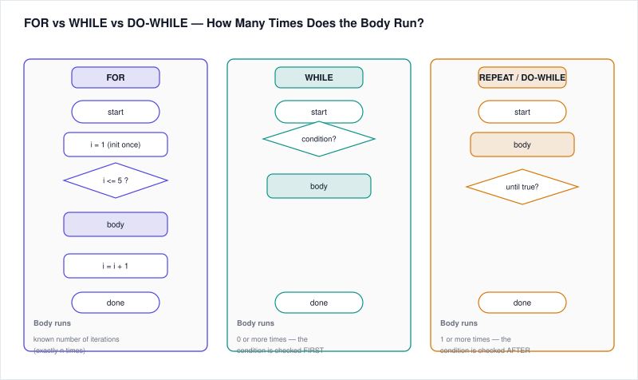
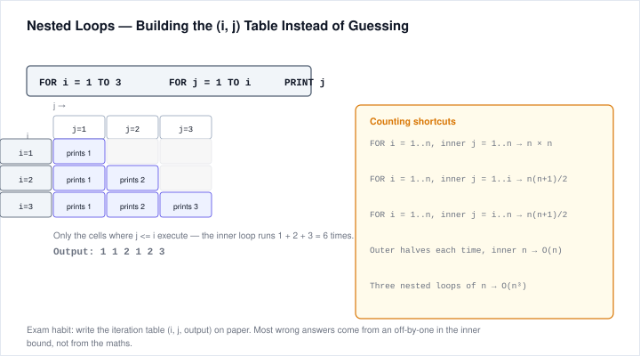
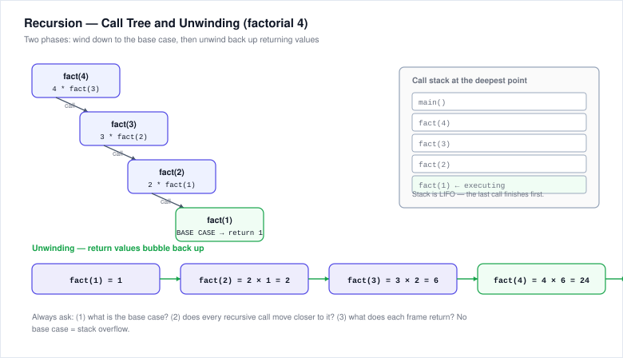
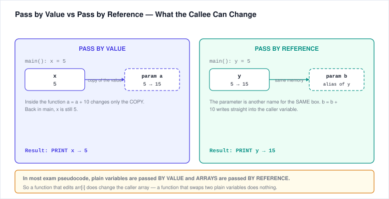
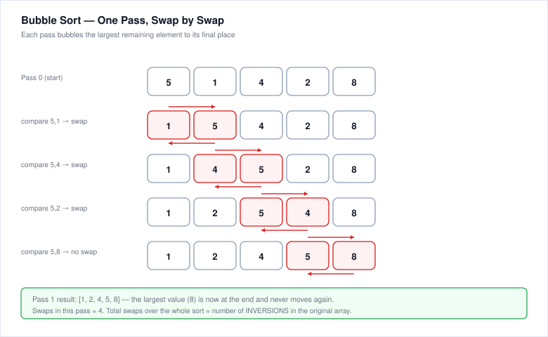

# 3. Pseudocode

> **Why this matters**: The syllabus explicitly states Pseudocode is "a very important section." It tests your ability to **trace code mentally** without running it. The skill is careful reading, not coding ability.

---

## 3.1 How to Trace Pseudocode — A Method

Before attempting questions, adopt this systematic approach:

1. **Read the whole code first.** Do NOT start executing line 1 until you see the end.
2. **List every variable on paper** with columns; update their values line by line.
3. **For loops**, write the iteration number and each variable after each cycle.
4. **For conditionals**, clearly mark which branch was taken.
5. **For functions**, draw a small call stack: note parameters, local variables, and return value.
6. **For recursion**, expand like a tree: f(n) = … f(n−1) … f(n−2).
7. **Watch for off-by-one errors** (especially loop boundaries like `i <= n` vs `i < n`).
8. **Watch for variable shadowing** — a parameter with the same name as a global may or may not update the global (pass-by-value vs pass-by-reference).
9. **Re-read the PRINT/OUTPUT statement** at the end — make sure you return what is asked (the final value, the array, a count, etc.).

---

## 3.2 IF-ELSE-ELSIF Chains

Pseudocode `IF/ELSE IF/ELSE` executes the **first matching condition** only; once a branch runs, the rest are skipped.

**Example:**
```
x = 15
IF x > 20 THEN
    PRINT "A"
ELSE IF x > 10 THEN
    PRINT "B"
ELSE IF x > 5 THEN
    PRINT "C"
ELSE
    PRINT "D"
END IF
```
Tracing: `x > 20` false → `x > 10` true → prints "B" and stops. "C" is NOT printed.

**Pitfall:** Dangling ELSE — in most pseudocode an `ELSE` belongs to the nearest unmatched IF. Use indentation or END IF markers.

---

## 3.3 FOR Loops and WHILE Loops

### FOR Loop
A FOR loop iterates over a sequence with a known start, end, and step.

```
sum = 0
FOR i = 1 TO 5
    sum = sum + i
ENDFOR
PRINT sum
```
Trace:
- i=1: sum=1
- i=2: sum=3
- i=3: sum=6
- i=4: sum=10
- i=5: sum=15
Output: `15`

> Note: In pseudocode `FOR i = 1 TO 5` usually includes **both** endpoints (iterates 5 times). If you see `TO 5 STEP 2`, it goes 1, 3, 5. If STEP is negative, it counts downward.

### WHILE Loop
WHILE checks the condition **before** executing the body. If it's false initially, body never runs.

```
n = 10
WHILE n > 0
    n = n - 3
ENDWHILE
PRINT n
```
Trace: n=10 → 7 → 4 → 1 → -2. Loop stops when n=−2 (−2 > 0 is false). Output: `-2`.

**Infinite loop red flag:** if the loop condition never becomes false (e.g., forgetting to decrement), it runs forever.

### REPEAT-UNTIL / DO-WHILE (less common, but appears)
Executes body **at least once**, checks condition at the end.

```
i = 0
REPEAT
    i = i + 1
UNTIL i >= 3
PRINT i
```
Output: `3`.

---



## 3.4 Nested Loops

For each iteration of the **outer** loop, the **inner** loop runs completely.

```
FOR i = 1 TO 3
    FOR j = 1 TO 2
        PRINT i, j
    ENDFOR
ENDFOR
```
Output:
```
1 1
1 2
2 1
2 2
3 1
3 2
```
Total iterations = outer × inner = 3 × 2 = **6**.

**Pattern recognition:** Many print-pattern questions use nested loops: outer loop = rows, inner loop = columns.

---



## 3.5 Functions, Parameters, and Return Values

Treat functions as black boxes until called. When called:
1. Arguments are bound to parameters.
2. Function body executes with its own local variables.
3. `RETURN` gives back a value; execution of the function stops there.
4. After return, control resumes at the call site with the returned value substituted.

```
FUNCTION add(a, b)
    RETURN a + b
ENDFUNCTION

FUNCTION double(x)
    RETURN x * 2
ENDFUNCTION

result = add(double(2), 3)
PRINT result
```
Trace: `double(2)` = 4, then `add(4, 3)` = 7. Output: `7`.

---

## 3.6 Recursion

A recursive function calls itself with a smaller input until it hits a **base case**.

### Factorial: n! = n × (n−1)! with base case 0! = 1
```
FUNCTION fact(n)
    IF n <= 1 THEN
        RETURN 1
    ELSE
        RETURN n * fact(n - 1)
    ENDIF
ENDFUNCTION
```
Trace `fact(4)`:
```
fact(4) = 4 * fact(3)
       = 4 * (3 * fact(2))
       = 4 * (3 * (2 * fact(1)))
       = 4 * (3 * (2 * 1))
       = 24
```



### Fibonacci: F(0)=0, F(1)=1, F(n)=F(n−1)+F(n−2)
```
FUNCTION fib(n)
    IF n == 0 THEN RETURN 0
    ELSE IF n == 1 THEN RETURN 1
    ELSE RETURN fib(n-1) + fib(n-2)
ENDIF
ENDFUNCTION
```
Trace `fib(5)` gives **5**. Sequence: 0,1,1,2,3,5.

**Trace tips:**
- Always identify base cases first.
- Draw the recursion as an expanding tree, then collapse bottom-up.
- Note that naive Fibonacci recalculates the same values many times (exponential calls).

---

## 3.7 Array Traversal

Arrays are 0-indexed or 1-indexed depending on pseudocode convention. Check the code carefully!

```
arr = [3, 7, 2, 9, 5]
n = 5
max = arr[0]
FOR i = 1 TO n-1
    IF arr[i] > max THEN
        max = arr[i]
    ENDIF
ENDFOR
PRINT max
```
Trace:
- i=1 arr[1]=7 → max=7
- i=2 arr[2]=2 → no change
- i=3 arr[3]=9 → max=9
- i=4 arr[4]=5 → no change
Output: `9` (finds the maximum).

---

## 3.8 Swapping & Finding Min/Max

### Swap (needs a temporary variable)
```
temp = a
a = b
b = temp
```
Or in some pseudocode: `SWAP a, b`.

### Find Min
```
minVal = arr[0]
FOR i = 1 TO LENGTH(arr)-1
    IF arr[i] < minVal THEN minVal = arr[i]
ENDFOR
```

---

## 3.9 String Operations

Common string operations in pseudocode (syntax varies, but semantics are universal):

| Operation | Meaning | Example |
|-----------|---------|---------|
| `LENGTH(s)` or `LEN(s)` | Number of characters | `LEN("hello") = 5` |
| `CONCAT(s1, s2)` or `s1 + s2` | Join two strings | `"hi" + "!" = "hi!"` |
| `SUBSTRING(s, start, length)` or s[start:end] | Slice/extract part | `MID("hello",1,3) = "ell"` (note 1-based in some variants, 0-based in others) |
| `INDEX_OF(s, ch)` | Position of first occurrence | `INDEX_OF("hello","l") = 2` (or 3 if 1-based) |
| `TO_UPPER(s)` / `TO_LOWER(s)` | Case conversion | `TO_UPPER("hi") = "HI"` |

**Example — reverse a string:**
```
s = "HELLO"
rev = ""
FOR i = LENGTH(s)-1 DOWNTO 0
    rev = rev + s[i]
ENDFOR
PRINT rev
```
Output: `OLLEH`.

---

## 3.10 Pass by Value vs Pass by Reference

| Pass by Value | Pass by Reference |
|---------------|-------------------|
| A **copy** of the value is passed to the function | A reference (pointer) to the original is passed |
| Changes inside the function do NOT affect the original | Changes inside the function DO affect the original |
| Default for primitive types (numbers, booleans) in most languages | Default for arrays/objects in most languages; sometimes for all variables in some languages (depends on the language) |

**Example (pass by value):**
```
FUNCTION change(x)
    x = 10
ENDFUNCTION
a = 5
change(a)
PRINT a       // prints 5 (unchanged)
```

**Example (pass by reference with array):**
```
FUNCTION addOne(arr)
    FOR i = 0 TO LENGTH(arr)-1
        arr[i] = arr[i] + 1
    ENDFOR
ENDFUNCTION
nums = [1,2,3]
addOne(nums)
PRINT nums    // prints [2,3,4]
```

> In pseudocode exams, if they don't explicitly state, look for clues: if the parameter name is used like an alias that modifies the caller's variable, treat as reference; if a local copy seems to be made, treat as value.

---



## 3.11 Basic Sorting — Bubble Sort Trace

Bubble Sort repeatedly swaps adjacent out-of-order elements, bubbling the largest to the end each pass.

```
arr = [5, 2, 8, 1]
n = 4
FOR i = 0 TO n-2
    FOR j = 0 TO n-2-i
        IF arr[j] > arr[j+1] THEN
            temp = arr[j]
            arr[j] = arr[j+1]
            arr[j+1] = temp
        ENDIF
    ENDFOR
ENDFOR
```
Pass-by-pass trace on `[5,2,8,1]`:

**i=0 (pass 1):**
- j=0: 5>2 swap → [2,5,8,1]
- j=1: 5<8 no swap
- j=2: 8>1 swap → [2,5,1,8]  (8 bubbled to end)

**i=1 (pass 2):**
- j=0: 2<5 no swap
- j=1: 5>1 swap → [2,1,5,8]

**i=2 (pass 3):**
- j=0: 2>1 swap → [1,2,5,8]

Final: `[1,2,5,8]`.

---



# Practice Questions — Pseudocode

**Trace each on paper first. Answers with walkthroughs are at the end.**

### Q1 — IF/ELSE chain
```
x = 7
IF x > 10 THEN
    result = "A"
ELSE IF x > 5 THEN
    result = "B"
ELSE IF x > 3 THEN
    result = "C"
ELSE
    result = "D"
ENDIF
PRINT result
```
What is printed?

### Q2 — FOR loop
```
s = 0
FOR k = 2 TO 6 STEP 2
    s = s + k
ENDFOR
PRINT s
```
What is printed?

### Q3 — WHILE loop
```
n = 20
count = 0
WHILE n > 0
    n = n - 3
    count = count + 1
ENDWHILE
PRINT count, n
```
What is printed?

### Q4 — Nested loops
```
m = 0
FOR i = 1 TO 4
    FOR j = i TO 4
        m = m + 1
    ENDFOR
ENDFOR
PRINT m
```
What is printed?

### Q5 — Function call stack
```
FUNCTION mystery(a, b)
    RETURN b - a
ENDFUNCTION

FUNCTION twice(z)
    RETURN z * 2
ENDFUNCTION

x = mystery(twice(3), twice(4))
PRINT x
```
What is printed?

### Q6 — Recursion (factorial)
```
FUNCTION f(n)
    IF n == 0 THEN
        RETURN 1
    ELSE
        RETURN n * f(n - 1)
    ENDIF
ENDFUNCTION
PRINT f(5)
```
What is printed?

### Q7 — Recursion (fibonacci)
```
FUNCTION fib(n)
    IF n <= 1 THEN
        RETURN n
    ENDIF
    RETURN fib(n-1) + fib(n-2)
ENDFUNCTION
PRINT fib(6)
```
What is printed?

### Q8 — Array traversal
```
arr = [4, 9, 2, 7, 13, 5]
n = 6
s = 0
FOR i = 0 TO n-1
    IF arr[i] % 2 == 0 THEN
        s = s + arr[i]
    ENDIF
ENDFOR
PRINT s
```
What is printed?

### Q9 — Swap and min
```
a = 3
b = 7
temp = a
a = b
b = temp
PRINT a, b
```
What is printed?

### Q10 — String operation
```
s = "ACCENTURE"
t = ""
FOR i = 0 TO LENGTH(s)-1
    IF i % 2 == 0 THEN
        t = t + s[i]
    ENDIF
ENDFOR
PRINT t
```
What is printed? (Assume 0-based indexing, s[0]='A')

### Q11 — Pass by value
```
FUNCTION foo(x)
    x = x + 10
    RETURN x
ENDFUNCTION
y = 5
z = foo(y)
PRINT y, z
```
What is printed?

### Q12 — Bubble sort (how many swaps in first pass?)
```
arr = [3, 6, 1, 8, 2]
n = 5
count = 0
FOR j = 0 TO n-2
    IF arr[j] > arr[j+1] THEN
        temp = arr[j]
        arr[j] = arr[j+1]
        arr[j+1] = temp
        count = count + 1
    ENDIF
ENDFOR
PRINT count
```
How many swaps occurred in this single pass?

### Q13 — Nested loop pattern count
```
FOR i = 1 TO 5
    FOR j = 1 TO i
        PRINT "*"
    ENDFOR
    PRINT new line
ENDFOR
```
How many stars are printed in TOTAL?

### Q14 — Loop off-by-one
```
FOR i = 10 TO 1 STEP -2
    PRINT i
ENDFOR
```
What numbers are printed?

### Q15 — Mixed (predict output)
```
n = 10
i = 1
result = 0
WHILE i <= n
    result = result + i
    i = i + 2
ENDWHILE
PRINT result
```
What is printed?

---

## Answers & Walkthroughs — Pseudocode

**A1.** `B`. x=7 fails >10, passes >5. Second branch taken, rest skipped.

**A2.** `12`. k takes values 2, 4, 6 → s = 0+2=2, +4=6, +6=12.

**A3.** `7 -1`. Trace count increments and n decrements:
n=20→17→14→11→8→5→2→−1 (7 iterations; loop stops when n=−1 because −1 > 0 is false).

**A4.** `10`. When i=1 inner runs 4 times (j=1..4), i=2 runs 3, i=3 runs 2, i=4 runs 1. Total = 4+3+2+1 = 10.

**A5.** `2`. twice(3)=6, twice(4)=8. mystery(6,8)=8−6=2.

**A6.** `120`. 5! = 5·4·3·2·1 = 120.

**A7.** `8`. fib(0)=0, fib(1)=1, fib(2)=1, fib(3)=2, fib(4)=3, fib(5)=5, fib(6)=8.

**A8.** `6`. Only even numbers summed: 4 + 2 = 6. (9, 7, 13, 5 are odd.)

**A9.** `7 3`. The temp swap exchanges a and b.

**A10.** `ACNUE`. Indices 0,2,4,6,8: s[0]='A', s[2]='C', s[4]='N', s[6]='U', s[8]='E'. (Length of "ACCENTURE" is 9 → indices 0–8.)

**A11.** `5 15`. y is unchanged (pass by value; primitive copies). z receives the returned value 5+10=15.

**A12.** `2`. Single pass on [3,6,1,8,2], j=0..3:
- j=0: 3<6 no swap
- j=1: 6>1 swap → [3,1,6,8,2], count=1
- j=2: 6<8 no swap
- j=3: 8>2 swap → [3,1,6,2,8], count=2
Total swaps: **2**.

**A13.** `15`. i=1 prints 1 star, i=2 prints 2, … i=5 prints 5. Total = 1+2+3+4+5 = 15.

**A14.** `10 8 6 4 2`. STEP -2 from 10 down to 1 includes 10,8,6,4,2 (0 is below 1 so excluded).

**A15.** `25`. Sums odd numbers 1+3+5+7+9 = 25 (i starts at 1, adds 2 each iteration; stops when i=11 which is >10).
