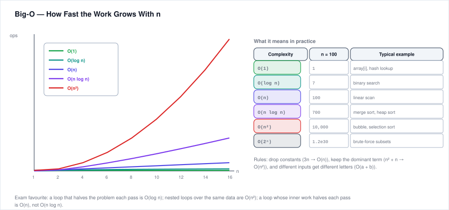
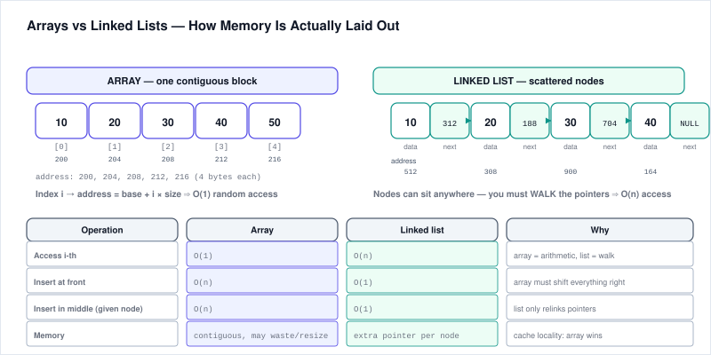
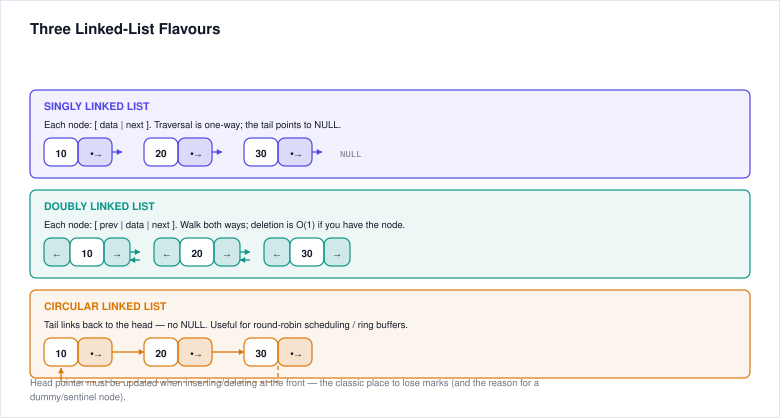
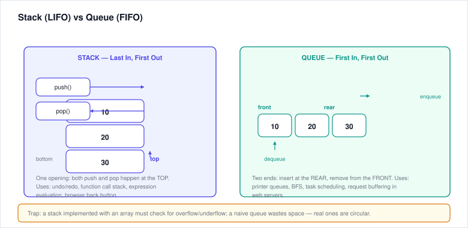
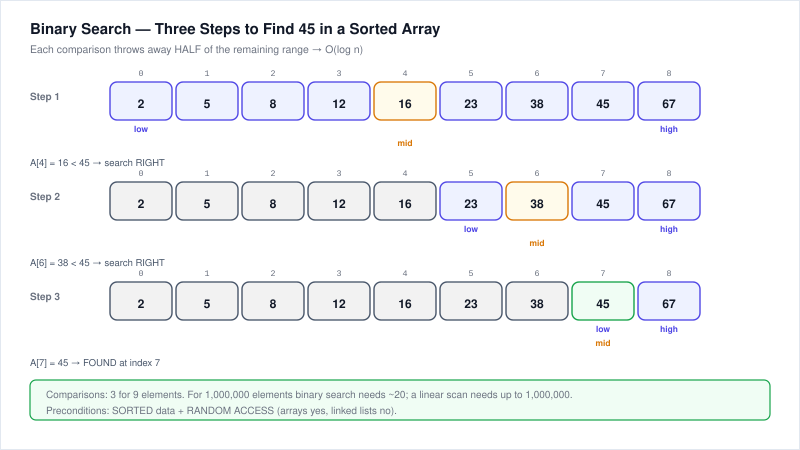
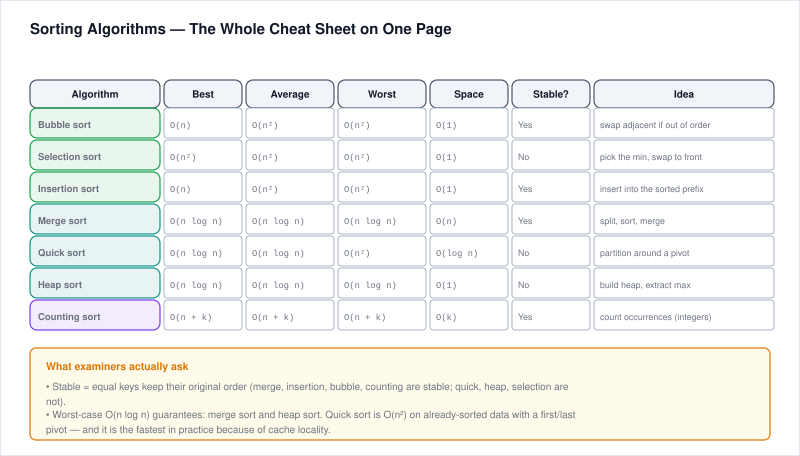
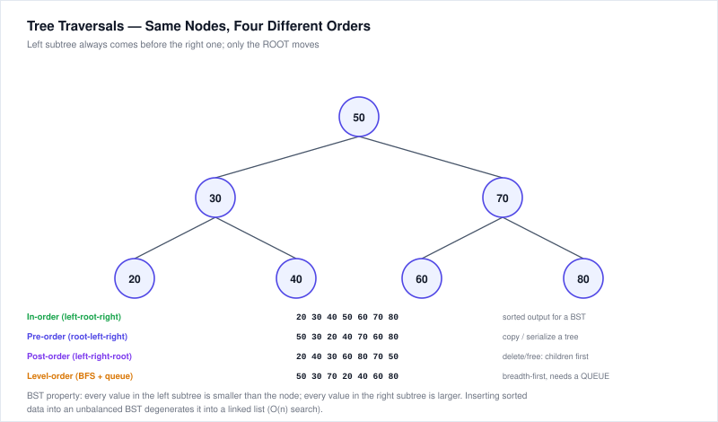

# 4. Data Structures & Algorithms — DSA (MCQs)

---

## 4.1 Big-O Notation

Big-O describes an algorithm's **worst-case growth rate** as input size n grows.

| Big-O | Name | Example algorithms |
|-------|------|--------------------|
| O(1) | Constant | Array index access, push/pop from stack top, hash table lookup (avg) |
| O(log n) | Logarithmic | Binary search on sorted array, balanced BST lookup |
| O(n) | Linear | Linear search, traversing an array/linked list once |
| O(n log n) | Linearithmic | Merge sort, Quick sort (avg case), Heap sort |
| O(n²) | Quadratic | Bubble sort, Selection sort, Insertion sort (worst), nested loops |
| O(n³) | Cubic | Triple nested loops, naïve matrix multiply |
| O(2ⁿ) | Exponential | Naive recursive Fibonacci, subsets enumeration |
| O(n!) | Factorial | Brute-force Traveling Salesman, permutations |

**Common MCQ rules:**
- Drop constants: `O(2n) = O(n)`, `O(3n² + n) = O(n²)`.
- Keep the dominant term: `O(n² + n log n) = O(n²)`.
- Loop over n items → O(n); two nested loops each to n → O(n²); halving input each step → O(log n).

---



## 4.2 Arrays

- **Contiguous** block of memory holding elements of the same type.
- **Random access** by index is O(1) (address = base + index × size).
- Insertion/deletion in the middle is O(n) (must shift elements); at the end is O(1) amortized.
- Searching an unsorted array is O(n) (linear search).
- In a sorted array, Binary Search is O(log n).

**Common operations:**
| Operation | Unsorted Array | Sorted Array |
|-----------|---------------|--------------|
| Access by index | O(1) | O(1) |
| Search | O(n) | O(log n) binary / O(n) linear |
| Insert at end | O(1) amortized | O(n) to keep sorted |
| Insert in middle | O(n) shifts | O(n) shifts |
| Delete by value | O(n) search + O(n) shifts | O(n) search + O(n) shifts |

---

## 4.3 Linked Lists



### Singly Linked List (SLL)
- Each node has **data** + **next pointer** pointing to the next node.
- Last node's next = NULL.
- Only forward traversal; no random access (O(n) to reach the k-th element).
- Insert/delete at head → O(1); at tail → O(n) unless tail pointer is maintained.

### Doubly Linked List (DLL)
- Each node has **data**, **next**, and **prev** pointers.
- Can traverse both forward and backward.
- Requires more memory; easier to delete a given node in O(1) if you hold a pointer to it.

### Circular Linked List
- Last node points back to first (useful for round-robin scheduling, circular queues).

**Head insertion (singly):**
```
newNode.next = head
head = newNode
```

**Tail insertion (singly):**
```
if head == null then head = newNode
else
    current = head
    while current.next != null: current = current.next
    current.next = newNode
```

**Comparison:**
| Operation | Array | Singly Linked List | Doubly Linked List |
|-----------|-------|--------------------|--------------------|
| Access by index | O(1) | O(n) | O(n) |
| Insert/delete at head | O(n) (shift) | O(1) | O(1) |
| Insert/delete at tail | O(1) amortized | O(n) w/o tail ptr | O(1) w/ tail ptr |
| Memory | Contiguous, no overhead | Per-node next ptr | Per-node next+prev ptr |

---



## 4.4 Stack

**LIFO** (Last In, First Out). Think of a stack of plates — you add to and remove from the top.

**Core operations:**
- `push(item)` — add to top, O(1).
- `pop()` — remove and return top, O(1).
- `peek()` / `top()` — view top without removing, O(1).
- `isEmpty()` — O(1).

**Implementations:** array with top pointer, or linked list with head as top.

**Applications:**
- Function call stack (recursion).
- Balanced parentheses/brackets `({[]})`.
- Reversing a string.
- Expression evaluation/conversion (infix → postfix, postfix eval).
- Undo functionality, browser back button.
- DFS (Depth-First Search).

---

## 4.5 Queue

**FIFO** (First In, First Out). Like a line at a ticket counter.

**Core operations:**
- `enqueue(item)` — add at rear, O(1).
- `dequeue()` — remove from front, O(1).
- `peek()` / `front()` — see front without removing, O(1).
- `isEmpty()` — O(1).

**Implementations:** array with front and rear indices; or linked list with head (front) + tail (rear).

**Circular Queue:**
- Uses an array with wrapping indices (rear = (rear+1) % size).
- Avoids wasted space that happens when front moves forward in a linear-array queue.
- Must distinguish full vs empty (uses a size counter, or leaves one slot empty, or a flag).

**Applications:**
- Scheduling (CPU ready queue, print spooling).
- BFS (Breadth-First Search).
- Buffers (keyboard, IO, streaming).
- Handling requests in order.

**Variants:**
- **Priority queue** — elements dequeued by priority, not arrival order (heap implementation).
- **Deque (double-ended queue)** — insert/remove from both ends.

---



## 4.6 Binary Search

**Prerequisites:** the array **must be sorted**.

**Algorithm:**
1. Compare target to the middle element.
2. If equal, found — return index.
3. If target < mid, search left half; else search right half.
4. Repeat on the chosen half until found or the range is empty.

**Time complexity:** O(log n). Each step halves the search space — only ~20 steps for 1 million items.
**Space:** O(1) iterative; O(log n) recursive (call stack).

Iterative version:
```
low = 0, high = n-1
while low <= high:
    mid = (low + high) / 2
    if arr[mid] == target: return mid
    else if arr[mid] < target: low = mid + 1
    else: high = mid - 1
return -1   // not found
```

**Common pitfalls:** off-by-one errors (low <= high vs low < high), calculating mid correctly (use `low + (high-low)/2` to avoid overflow in real languages), forgetting to sort before searching.

---



## 4.7 Sorting Algorithms

| Algorithm | Best | Average | Worst | Space | Stable? | In-place? | Notes |
|-----------|------|---------|-------|-------|---------|-----------|-------|
| **Bubble Sort** | O(n) | O(n²) | O(n²) | O(1) | Yes | Yes | Repeatedly swaps adjacent; very slow; simple. |
| **Selection Sort** | O(n²) | O(n²) | O(n²) | O(1) | No | Yes | Finds min each pass and places it; minimal swaps. |
| **Insertion Sort** | O(n) | O(n²) | O(n²) | O(1) | Yes | Yes | Inserts each element into correct position; fast for nearly-sorted data. |
| **Merge Sort** | O(n log n) | O(n log n) | O(n log n) | O(n) | Yes | No | Divide & conquer; stable; used in external sort; good for linked lists. |
| **Quick Sort** | O(n log n) | O(n log n) | O(n²) | O(log n) avg | No (usually) | Yes | Partition around pivot; fast in practice; worst case on bad pivot (e.g., sorted array with first element pivot). |
| **Heap Sort** | O(n log n) | O(n log n) | O(n log n) | O(1) | No | Yes | Builds max heap, extracts max repeatedly. |

### Key Points for MCQs
- **Fastest general-purpose on average:** Quick Sort.
- **Guaranteed O(n log n):** Merge Sort and Heap Sort.
- **Best for small / nearly-sorted data:** Insertion Sort.
- **Stable sorts** preserve the relative order of equal elements: Bubble, Insertion, Merge.
- **In-place** means uses only O(1) extra memory.
- Quick Sort worst case is O(n²); Merge Sort needs O(n) extra space.

---



## 4.8 Tree Terminology & BST

**Tree:** connected acyclic graph of nodes. Hierarchical (not linear).

Key terms:
- **Root** — topmost node, no parent.
- **Leaf** — node with no children.
- **Parent/Child/Sibling** — familial relations as expected.
- **Edge** — connection between parent and child.
- **Depth of a node** — number of edges from root to that node (root depth = 0).
- **Height of a node** — number of edges from that node to its deepest leaf. Leaf height = 0.
- **Height of a tree** — height of root.
- **Level** — depth + 1 (root at level 1).
- **Subtree** — any node plus all its descendants.

### Binary Tree
- Each node has at most **two** children (left and right).

### Binary Search Tree (BST)
- A binary tree with the ordering property:
  - For every node, **all keys in its left subtree are less than the node's key**.
  - **All keys in its right subtree are greater than the node's key**.
- (Tie-breaker for duplicates varies: equal keys may go either left or right.)
- **In-order traversal (left → root → right) gives keys in ascending sorted order.**
- Search, insert, delete average O(log n) if balanced; worst O(n) if skewed (e.g., inserting in order gives a linked-list-shaped tree). Balanced variants (AVL, Red-Black) guarantee O(log n).

### Common Traversals
- **Pre-order:** root → left → right (copying trees, prefix expression).
- **In-order:** left → root → right (sorted order for BST).
- **Post-order:** left → right → root (deleting trees, postfix expression).
- **Level-order (BFS):** top-down, left-to-right row by row (uses a queue).

---



# Practice Questions — DSA MCQs

**(Answers at the end)**

### Big-O
1. Binary search on a sorted array has what time complexity?
   a) O(1)  b) O(n)  c) O(log n)  d) O(n log n)
2. Which sorting algorithm has O(n²) worst-case time?
   a) Merge sort  b) Bubble sort  c) Quick sort (best case)  d) Heap sort
3. Accessing an element by index in an array is:
   a) O(n)  b) O(log n)  c) O(1)  d) O(n²)
4. Two nested loops each iterating n times give:
   a) O(n)  b) O(n log n)  c) O(n²)  d) O(2ⁿ)
5. Which of the following grows fastest as n increases?
   a) O(n²)  b) O(n log n)  c) O(n)  d) O(2ⁿ)

### Arrays & Linked Lists
6. Inserting at the beginning of a singly linked list is:
   a) O(1)  b) O(n)  c) O(log n)  d) O(n²)
7. Which of the following is NOT true of arrays?
   a) Contiguous memory  b) Random access O(1)  c) Dynamic size by default in all languages  d) Insertion in middle requires shifting
8. A doubly linked list node contains:
   a) Only data  b) Data + next pointer  c) Data + next + prev pointers  d) Data + index

### Stacks & Queues
9. Which data structure is LIFO?
   a) Queue  b) Stack  c) Linked list  d) Tree
10. Checking balanced parentheses efficiently uses a:
    a) Queue  b) Stack  c) Array sorted  d) Hash table
11. A queue is used for:
    a) BFS  b) DFS  c) Recursion call stack  d) Reversing a string
12. In a circular queue, what problem is avoided?
    a) The need for enqueue  b) Wasted space as front moves forward  c) The need for a dequeue op  d) Having to use pointers

### Binary Search
13. The prerequisite for binary search is:
    a) The array is unsorted  b) The array is sorted  c) The array is circular  d) The array has unique elements
14. After one failed comparison in binary search on a 1024-element array, the remaining search space is about:
    a) 1023 elements  b) 512 elements  c) 256 elements  d) 1 element

### Sorting
15. Which sort guarantees O(n log n) in the worst case?
    a) Quick sort  b) Bubble sort  c) Insertion sort  d) Merge sort
16. Which sort is stable?
    a) Quick sort  b) Selection sort  c) Heap sort  d) Merge sort
17. Which sort is best for an already nearly-sorted array?
    a) Insertion sort  b) Selection sort  c) Bubble sort  d) Quick sort

### Trees & BST
18. In a BST, in-order traversal yields:
    a) Pre-order sequence  b) Sorted ascending order  c) Reverse sorted order  d) Level order
19. The height of a tree with one node (only root) is:
    a) 0  b) 1  c) Undefined  d) -1
20. A node with no children is called a:
    a) Root  b) Branch  c) Leaf  d) Parent

---

## Answer Key — DSA MCQs

1. c | 2. b | 3. c | 4. c | 5. d
6. a | 7. c | 8. c | 9. b | 10. b
11. a | 12. b | 13. b | 14. b | 15. d
16. d | 17. a | 18. b | 19. a | 20. c
