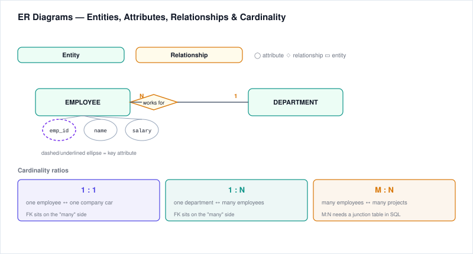
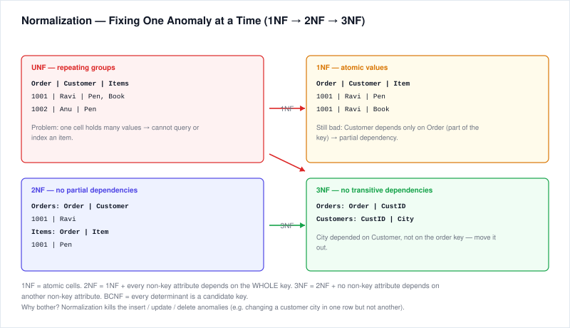
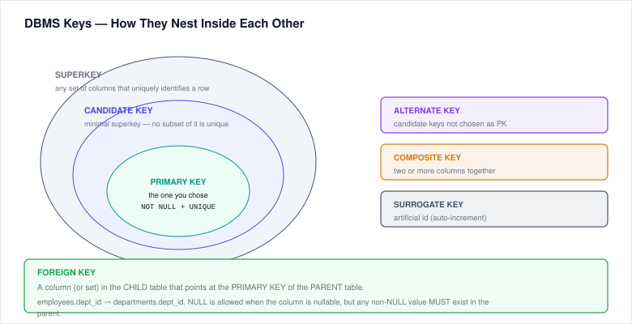
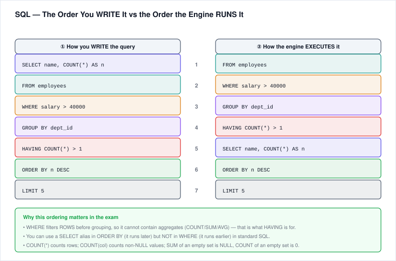
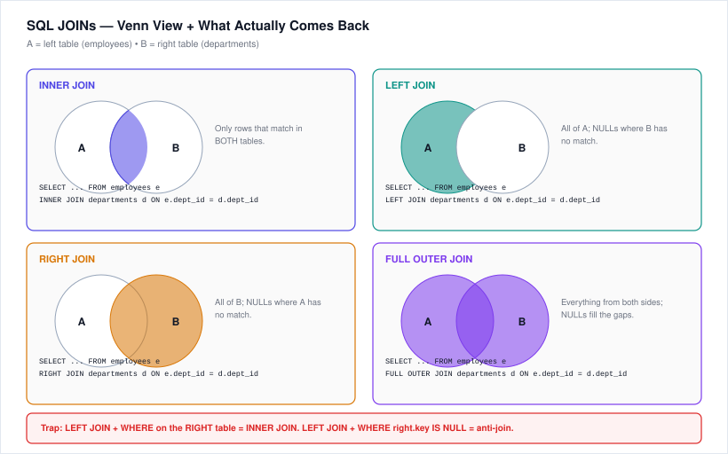
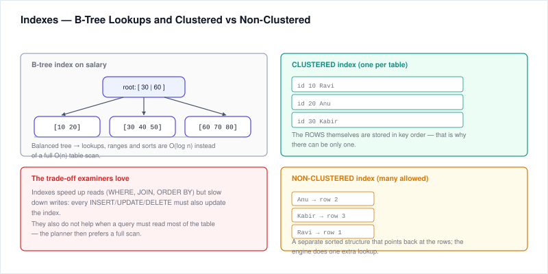

# 5. DBMS (MCQs)

---

## 5.1 ER Diagrams

An **Entity-Relationship (ER) diagram** models database structure graphically.

### Core Components
- **Entity** — a real-world object/thing about which data is stored. Represented as a **rectangle**.
  - *Strong entity*: exists on its own (e.g., Student, Employee).
  - *Weak entity*: depends on another entity (e.g., Dependent of Employee), shown with a double rectangle; has a partial key (discriminator) rather than its own primary key.
- **Attribute** — a property of an entity. Represented as an **oval**.
  - *Key attribute* (primary key) → underlined oval.
  - *Composite attribute*: can be split into parts (e.g., Name → First, Middle, Last).
  - *Multivalued attribute*: can hold many values (e.g., multiple phone numbers) → double oval.
  - *Derived attribute*: computed from other attributes (e.g., Age from DOB) → dashed oval.
- **Relationship** — association between entities. Represented as a **diamond**.
  - Lines connect entities to relationships.
- **Cardinality / Participation** — how many entities of one type relate to another.

### Cardinality Ratios
- **One-to-One (1:1)** — e.g., Person ↔ Passport.
- **One-to-Many (1:N)** — e.g., Department → Employees (one department has many employees; each employee belongs to one department).
- **Many-to-Many (M:N)** — e.g., Student ↔ Course (a student enrolls in many courses; a course has many students). M:N relationships typically become a separate "junction/link" table in the relational model (with two foreign keys).

### Participation Constraints
- **Total participation** (mandatory): every entity in the set must participate in the relationship (double line).
- **Partial participation** (optional): some entities may not participate (single line).

---



## 5.2 Normalization

Normalization is the process of organizing a database to reduce **redundancy** and avoid **anomalies** (insert, update, delete).

### Functional Dependency (FD)
`X → Y` means given X, you can uniquely determine Y.

### Normal Forms

**1NF (First Normal Form)**
- Every column holds **atomic** (indivisible) values.
- No repeating groups or multi-valued columns.
- Each row is unique (no duplicate rows).

Violation: a "Phone" column storing "999-111, 888-222" in one cell; or multiple phone columns per row.

**2NF (Second Normal Form)**
- Must be in 1NF.
- **No partial dependency**: every non-key attribute depends on the **entire primary key**, not just part of it.
- (This matters mainly for composite primary keys.)

Violation: In `Enroll(student_id, course_id, student_name, course_name)`, with PK (student_id, course_id), `student_name` depends only on `student_id` (partial dependency). Split into Student, Course, Enroll tables.

**3NF (Third Normal Form)**
- Must be in 2NF.
- **No transitive dependency**: non-key attributes must depend only on the primary key, not on other non-key attributes.
- Rule of thumb: "Every non-key attribute must provide a fact about the key, the whole key, and nothing but the key."

Violation: In `Employee(emp_id, name, dept_id, dept_name)`, `dept_name` depends on `dept_id`, which itself is not a key (transitive dependency). Move dept_name to a separate Department table.

**BCNF (Boyce-Codd Normal Form)**
- Stricter version of 3NF.
- For every non-trivial FD `X → Y`, **X must be a superkey**.
- Eliminates anomalies that 3NF misses (arises when multiple overlapping candidate keys exist).

### Denormalization
Sometimes we intentionally add redundancy (denormalize) for **read performance** in data warehouses/reporting.

### Anomalies avoided by normalization
- **Insert anomaly:** can't insert certain facts without other facts (e.g., can't record a department until it has employees).
- **Update anomaly:** changing a fact requires updating many rows, risking inconsistency.
- **Delete anomaly:** deleting rows loses unrelated facts (e.g., deleting the last employee removes the department).

---



## 5.3 Keys in DBMS

| Key Type | Definition |
|----------|------------|
| **Superkey** | Any set of attributes that uniquely identifies a row. Can have extra attributes (e.g., {email}, {email, name}). |
| **Candidate Key** | Minimal superkey — no redundant attributes. A table can have multiple candidate keys. |
| **Primary Key (PK)** | The candidate key chosen to uniquely identify rows. Cannot be NULL. One per table. |
| **Alternate Key** | Candidate keys that were NOT chosen as primary key. |
| **Foreign Key (FK)** | An attribute(s) in one table that refers to the primary key of another table. Enforces referential integrity. Can be NULL (optional relationship) or multiple. |
| **Composite Key** | A key composed of **two or more attributes** together (e.g., (student_id, course_id) in an enrollment table). |
| **Surrogate Key** | Artificial/system-generated key with no business meaning (e.g., auto-increment `id`, UUID). Used when natural keys are bulky or unstable. |

**Properties of a primary key:**
- Unique across all rows.
- Not NULL.
- Immutable (ideally).
- Minimal.

---



## 5.4 SQL

### Core Clauses and Order
```sql
SELECT columns
FROM table
WHERE row-filter
GROUP BY grouping-columns
HAVING group-filter
ORDER BY sort-columns [ASC|DESC]
LIMIT n;
```
**Order of execution (conceptual):** FROM → WHERE → GROUP BY → HAVING → SELECT → ORDER BY → LIMIT.

- `WHERE` filters **rows before** grouping (can't use aggregates here).
- `HAVING` filters **groups after** aggregation (used with GROUP BY).
- `DISTINCT` removes duplicate rows from the result.
- `ORDER BY` sorts; `ASC` default, `DESC` for descending.



### Aggregates
- `COUNT()`, `SUM()`, `AVG()`, `MIN()`, `MAX()`.
- `COUNT(*)` counts all rows; `COUNT(column)` counts non-NULL values.

### JOIN Types

| Join | What it returns |
|------|-----------------|
| **INNER JOIN** | Only rows where the join condition matches in BOTH tables. |
| **LEFT JOIN (LEFT OUTER JOIN)** | All rows from the left table, plus matching rows from the right (NULLs where no match). |
| **RIGHT JOIN (RIGHT OUTER JOIN)** | All rows from the right table, plus matching from the left (NULLs where no match). |
| **FULL JOIN (FULL OUTER JOIN)** | All rows from both tables; NULLs where no match. |
| **CROSS JOIN** | Cartesian product (every combination of rows from both tables) — rarely wanted. |
| **SELF JOIN** | A table joined to itself (e.g., employee joined with manager). |

**Example — inner join:**
```sql
SELECT e.name, d.dept_name
FROM employees e
INNER JOIN departments d ON e.dept_id = d.dept_id;
```

**Example — LEFT join to find employees with no department:**
```sql
SELECT e.name
FROM employees e
LEFT JOIN departments d ON e.dept_id = d.dept_id
WHERE d.dept_id IS NULL;
```

---



## 5.5 Transactions & ACID

A **transaction** is a logical unit of work (one or more SQL statements) that must succeed or fail as a whole.

### ACID Properties
- **Atomicity** — "All or nothing." If any part fails, the entire transaction rolls back; no partial effects. (Managed via commit/rollback.)
- **Consistency** — Transaction brings the database from one valid state to another; all constraints (keys, rules, triggers) are maintained.
- **Isolation** — Concurrent transactions don't interfere with each other. Each appears to run alone. Controlled by isolation levels (Read Uncommitted, Read Committed, Repeatable Read, Serializable).
- **Durability** — Once a transaction commits, its changes persist even after a system crash/power loss (via transaction logs/write-ahead logs).

### Transaction Controls
- `BEGIN TRANSACTION` (or `START TRANSACTION`).
- `COMMIT` — permanently save changes.
- `ROLLBACK` — undo changes since begin.
- `SAVEPOINT` — mark a point to partially roll back to.

### Common concurrency anomalies
- **Dirty read** — reading uncommitted changes by another transaction that later rolls back.
- **Non-repeatable read** — re-reading same row gives different value because another committed changed it.
- **Phantom read** — a query re-run returns different set of rows due to another transaction's inserts/deletes.

---

## 5.6 Indexing

An **index** is a data structure (usually B-tree or hash) that speeds up data retrieval at the cost of extra storage and slower writes (inserts/updates must maintain the index).

### Clustered vs Non-Clustered Indexes

| Feature | Clustered Index | Non-Clustered Index |
|---------|------------------|---------------------|
| Ordering | Determines the **physical order** of rows in the table (data is stored in index order) | Separate structure pointing to rows; does not change physical order |
| Per table | **Only one** per table (because data rows can be in only one order) | Up to ~hundreds (multiple allowed) |
| Speed | Often faster to return range queries | Fast for point lookups; may need a key lookup to fetch other columns |
| Default | Primary key is usually clustered by default (in SQL Server/InnoDB) | Secondary indexes; UNIQUE constraints often create these |
| Analogy | Like a phone book sorted by last name (data is on the page) | Like a book's index (separate list of terms with page references) |

Other concepts:
- **Composite index** — spans multiple columns; order matters (leftmost-prefix rule).
- **Unique index** — enforces that indexed values are unique across rows.
- **Full-text index** — for fast text search within large text columns.

**Use indexes on:** columns used in WHERE, JOIN, ORDER BY, GROUP BY. Avoid indexing columns that are rarely queried or frequently modified, or small tables.

---



## 5.7 Triggers, Views, Stored Procedures (Concepts)

### View
- A virtual table based on a stored `SELECT` query.
- Does not physically store data (except materialized views in some DBMS).
- Used to simplify complex queries, restrict access to specific columns/rows (security), or provide a consistent interface.
- Can be updatable if it meets certain rules (no GROUP BY, no DISTINCT, no aggregates, single table, etc.).
- Created with `CREATE VIEW view_name AS SELECT ...`.

### Stored Procedure
- A named, precompiled set of SQL statements (with optional logic: IF, loops, variables) stored in the database.
- Can accept parameters, perform multiple actions, return multiple results.
- Called with `CALL` or `EXEC`.
- Benefits: code reuse, encapsulation of business logic, reduced network traffic, improved performance (precompiled execution plan).

### Trigger
- A special stored procedure that **automatically fires** when a specific event occurs on a table/view: INSERT, UPDATE, DELETE (and sometimes DDL events).
- Timing keywords: `BEFORE` or `AFTER` the event (some DBs support `INSTEAD OF`).
- Uses: auditing/logging changes, enforcing complex business rules, maintaining derived/summary data, cascading actions.
- Triggers can make debugging harder because they fire implicitly.

### Quick comparison

| Feature | View | Stored Procedure | Trigger |
|---------|------|------------------|---------|
| Invoked by | User queries it (SELECT) | Explicitly called (CALL/EXEC) | Fires automatically on event |
| Returns | Table-like result set | Can return 0+ values/resultsets | No return to caller |
| Can modify data? | Sometimes (updatable views) | Yes | Yes |
| Parameters | No | Yes (IN/OUT/INOUT) | No (uses OLD/NEW row references) |

---

# Practice Questions — DBMS MCQs

**(Answers at the end)**

### ER Diagrams & Cardinality
1. In an ER diagram, an entity is represented by a:
   a) Diamond  b) Rectangle  c) Oval  d) Triangle
2. A many-to-many relationship in an ER model usually maps in the relational model to:
   a) A single table with a composite PK  b) Two tables only  c) A junction/link table with two FKs  d) A trigger
3. A weak entity is:
   a) An entity with no attributes  b) An entity dependent on a strong entity for its identity  c) Any entity with a primary key  d) A deleted entity

### Normalization
4. A table with repeating groups or multi-valued columns violates:
   a) 1NF  b) 2NF  c) 3NF  d) BCNF
5. 2NF primarily removes:
   a) Transitive dependencies  b) Partial dependencies on composite keys  c) Multi-valued attributes  d) Redundant joins
6. A table is in 3NF if it is in 2NF and:
   a) All attributes are atomic  b) No transitive dependencies of non-keys on the PK  c) Every dependency's left side is a superkey  d) There are no NULLs
7. In BCNF, for every non-trivial functional dependency X → Y, X must be a:
   a) Foreign key  b) Candidate key  c) Superkey  d) Unique attribute

### Keys
8. A foreign key:
   a) Must always be unique  b) References a primary key (or unique key) in another table  c) Cannot be NULL  d) Must be an integer
9. An artificial system-generated key with no business meaning is a:
   a) Composite key  b) Candidate key  c) Surrogate key  d) Alternate key
10. A primary key composed of multiple columns is called:
    a) Foreign key  b) Composite key  c) Surrogate key  d) Partial key

### SQL
11. Which clause filters groups AFTER aggregation?
    a) WHERE  b) HAVING  c) GROUP BY  d) ORDER BY
12. Which JOIN returns only matching rows from both tables?
    a) LEFT JOIN  b) RIGHT JOIN  c) INNER JOIN  d) FULL JOIN
13. `COUNT(*)` returns:
    a) Count of non-NULL values in first column  b) Count of all rows including NULLs  c) Count of distinct values  d) Zero always
14. The correct logical order of SQL clauses is:
    a) SELECT → FROM → WHERE → GROUP BY → HAVING → ORDER BY
    b) FROM → WHERE → GROUP BY → HAVING → SELECT → ORDER BY
    c) FROM → GROUP BY → WHERE → HAVING → SELECT → ORDER BY
    d) SELECT → ORDER BY → FROM → WHERE

### Transactions & ACID
15. Which ACID property ensures that a completed transaction's changes survive a crash?
    a) Atomicity  b) Consistency  c) Isolation  d) Durability
16. The "all or nothing" principle describes:
    a) Atomicity  b) Consistency  c) Isolation  d) Durability
17. Reading uncommitted data from another transaction is called:
    a) Phantom read  b) Non-repeatable read  c) Dirty read  d) Lost update

### Indexing
18. How many clustered indexes can a table have?
    a) Unlimited  b) One  c) Two  d) Zero or one (depending on DB)
19. A non-clustered index:
    a) Physically reorders rows  b) Is a separate structure pointing to rows  c) Cannot be used for lookups  d) Is always unique

### Views, Procedures, Triggers
20. Which object automatically fires when a row is inserted/updated/deleted?
    a) View  b) Stored procedure  c) Trigger  d) Index
21. A view is:
    a) A backup copy of a table  b) A virtual table defined by a query  c) A stored procedure  d) An index

---

## Answer Key — DBMS MCQs

1. b | 2. c | 3. b | 4. a | 5. b
6. b | 7. c | 8. b | 9. c | 10. b
11. b | 12. c | 13. b | 14. b | 15. d
16. a | 17. c | 18. b | 19. b | 20. c
21. b
