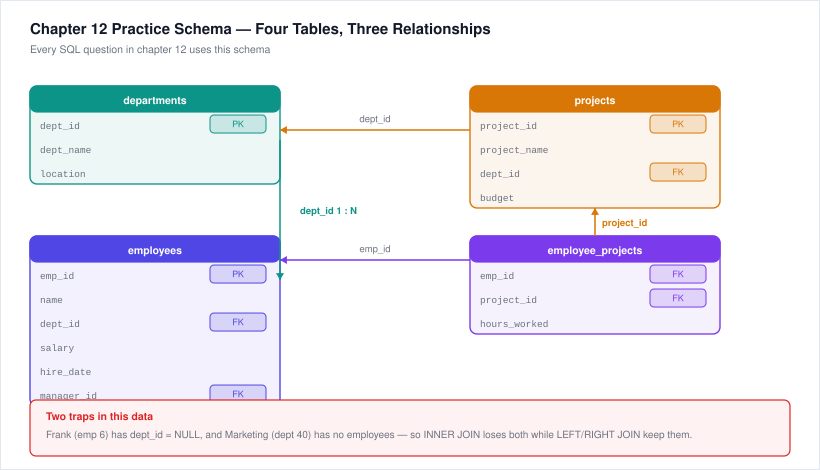

# 12. SQL Practice Queries (Coding Round)

Accenture's new coding round often includes a **SQL query problem** alongside the DSA and frontend tasks. You're typically given 2–3 tables and asked to write a SELECT with JOINs, GROUP BY, HAVING, and/or ORDER BY. This chapter gives you the exact patterns tested, with worked solutions.

---

## 12.1 Quick Refresher — The SQL Clauses You Must Know

```sql
SELECT   [columns or aggregates]
FROM     [table]
JOIN     [other_table] ON [condition]     -- optional, multiple JOINs allowed
WHERE    [row-level filter]               -- before grouping
GROUP BY [grouping columns]               -- split rows into groups
HAVING   [group-level filter]             -- after grouping
ORDER BY [columns] [ASC|DESC]             -- sort
LIMIT    [n];                             -- top N (varies: SQL Server uses TOP n)
```

Execution order (mental model): **FROM → JOIN → WHERE → GROUP BY → HAVING → SELECT → ORDER BY → LIMIT**.

### JOIN types recap
- **INNER JOIN** — only matching rows on both sides.
- **LEFT JOIN** — all rows from left table, NULLs for missing right rows.
- **RIGHT JOIN** — all rows from right table, NULLs for missing left rows.
- **FULL OUTER JOIN** — all rows from both sides.
- **SELF JOIN** — a table joined to itself (e.g., employees and their managers).

### Aggregates
- `COUNT(*)`, `COUNT(col)`, `SUM(col)`, `AVG(col)`, `MIN(col)`, `MAX(col)`.
- Alias them with `AS name` so you can reference them easily and the output column has a name.
- **Never use an aggregate in WHERE** — use HAVING instead.

---

## 12.2 Practice Schema (used by all queries below)

**employees**
| emp_id | name    | dept_id | salary | hire_date  | manager_id |
|--------|---------|---------|--------|------------|------------|
| 1      | Alice   | 10      | 60000  | 2020-03-15 | NULL       |
| 2      | Bob     | 20      | 75000  | 2019-07-01 | 1          |
| 3      | Charlie | 10      | 50000  | 2021-01-10 | 1          |
| 4      | Diana   | 30      | 85000  | 2018-11-20 | NULL       |
| 5      | Eve     | 20      | 70000  | 2022-05-05 | 2          |
| 6      | Frank   | NULL    | 45000  | 2023-02-28 | 2          |

**departments**
| dept_id | dept_name    | location  |
|---------|--------------|-----------|
| 10      | HR           | New York  |
| 20      | Engineering  | London    |
| 30      | Finance      | New York  |
| 40      | Marketing    | Tokyo     |

**projects**
| project_id | project_name | dept_id | budget |
|------------|--------------|---------|--------|
| 101        | Atlas        | 20      | 500000 |
| 102        | Titan        | 20      | 300000 |
| 103        | Phoenix      | 30      | 200000 |
| 104        | Nova         | 10      | 80000  |

**employee_projects** (many-to-many linking)
| emp_id | project_id | hours_worked |
|--------|------------|--------------|
| 2      | 101        | 120          |
| 2      | 102        | 80           |
| 5      | 101        | 100          |
| 4      | 103        | 150          |
| 3      | 104        | 40           |
| 1      | 104        | 30           |

Try to write each query yourself before peeking at the solution.

---



## 12.3 Queries — Try These

### Q1. Simple SELECT with WHERE
List all employees earning more than 60,000. Show name and salary, ordered by salary descending.

<details>
<summary><b>Reveal solution</b></summary>

```sql
SELECT name, salary
FROM employees
WHERE salary > 60000
ORDER BY salary DESC;
```
Result:
- Bob | 75000
- Diana | 85000
- Eve | 70000
</details>

---

### Q2. INNER JOIN
Show each employee's name alongside their department name. Exclude employees with no department and departments with no employees.

<details><summary><b>Reveal solution</b></summary>

```sql
SELECT e.name, d.dept_name
FROM employees e
INNER JOIN departments d ON e.dept_id = d.dept_id;
```
(Frank, dept_id NULL, is excluded. Marketing dept 40, having no employees, is excluded.)
</details>

---

### Q3. LEFT JOIN (keep all employees)
Show all employees and their department name, including those not assigned to any department.

<details><summary><b>Reveal solution</b></summary>

```sql
SELECT e.name, d.dept_name
FROM employees e
LEFT JOIN departments d ON e.dept_id = d.dept_id;
```
Frank appears with `dept_name` NULL.
</details>

---

### Q4. LEFT JOIN trick — find unmatched rows
List employees who do NOT belong to any department.

<details><summary><b>Reveal solution</b></summary>

```sql
SELECT e.*
FROM employees e
LEFT JOIN departments d ON e.dept_id = d.dept_id
WHERE d.dept_id IS NULL;
```
Returns only Frank. The key: after LEFT JOIN, rows that had no match have NULLs for all right-side columns, so filtering WHERE a right-side column IS NULL picks exactly the unmatched left rows.
</details>

---

### Q5. GROUP BY with aggregate
Find the average salary per department. Show dept_name and average salary. Order by average salary descending.

<details><summary><b>Reveal solution</b></summary>

```sql
SELECT d.dept_name, AVG(e.salary) AS avg_salary
FROM employees e
INNER JOIN departments d ON e.dept_id = d.dept_id
GROUP BY d.dept_id, d.dept_name
ORDER BY avg_salary DESC;
```
Result:
- Finance | 85000
- Engineering | 72500
- HR | 55000

We use INNER JOIN here (not LEFT JOIN) because departments without employees would produce NULL averages; either choice is defensible depending on the question.
</details>

---

### Q6. GROUP BY with HAVING
Same as Q5 but only show departments whose average salary is above 60,000.

<details><summary><b>Reveal solution</b></summary>

```sql
SELECT d.dept_name, AVG(e.salary) AS avg_salary
FROM employees e
INNER JOIN departments d ON e.dept_id = d.dept_id
GROUP BY d.dept_id, d.dept_name
HAVING AVG(e.salary) > 60000
ORDER BY avg_salary DESC;
```
Returns:
- Finance | 85000
- Engineering | 72500

(HAVING filters groups, WHERE filters rows. This is a classic exam question; if you put `AVG(...) > 60000` in WHERE, it will error.)
</details>

---

### Q7. COUNT with GROUP BY
Count the number of employees in each department. Show dept_name and count. Include departments that have zero employees.

<details><summary><b>Reveal solution</b></summary>

```sql
SELECT d.dept_name, COUNT(e.emp_id) AS emp_count
FROM departments d
LEFT JOIN employees e ON d.dept_id = e.dept_id
GROUP BY d.dept_id, d.dept_name
ORDER BY emp_count DESC;
```
Key details:
- Start from `departments` and LEFT JOIN `employees` so all departments are kept.
- Use `COUNT(e.emp_id)` not `COUNT(*)`, because COUNT(*) counts the NULL-extended rows too (Marketing would incorrectly show 1 instead of 0). COUNT of a specific column counts only non-NULLs.

Result:
- Engineering | 2
- HR | 2
- Finance | 1
- Marketing | 0
</details>

---

### Q8. Three-table JOIN (many-to-many via junction table)
Show each employee name, project name, and hours worked, ordered by employee name.

<details><summary><b>Reveal solution</b></summary>

```sql
SELECT e.name, p.project_name, ep.hours_worked
FROM employee_projects ep
INNER JOIN employees e ON ep.emp_id = e.emp_id
INNER JOIN projects p  ON ep.project_id = p.project_id
ORDER BY e.name;
```
You join through the junction table: employees ← employee_projects → projects.
</details>

---

### Q9. Aggregation with multiple tables
Find the total hours worked on each project. Show project_name and total hours, ordered by total hours descending.

<details><summary><b>Reveal solution</b></summary>

```sql
SELECT p.project_name, SUM(ep.hours_worked) AS total_hours
FROM projects p
LEFT JOIN employee_projects ep ON p.project_id = ep.project_id
GROUP BY p.project_id, p.project_name
ORDER BY total_hours DESC;
```
Result:
- Atlas | 220 (Bob 120 + Eve 100)
- Phoenix | 150
- Titan | 80
- Nova | 70 (Charlie 40 + Alice 30)
</details>

---

### Q10. LIKE / pattern matching
Find employees whose name starts with "A".

<details><summary><b>Reveal solution</b></summary>

```sql
SELECT name
FROM employees
WHERE name LIKE 'A%';
```
- `%` = any sequence of characters.
- `_` = exactly one character.
- `'A%'` means starts with A; `'%a'` ends with a; `'%a%'` contains a anywhere.
</details>

---

### Q11. IN subquery
List employees who work in departments located in "New York".

<details><summary><b>Reveal solution</b></summary>

```sql
SELECT name
FROM employees
WHERE dept_id IN (
    SELECT dept_id FROM departments WHERE location = 'New York'
);
```
Alternatively with JOIN:
```sql
SELECT e.name
FROM employees e
INNER JOIN departments d ON e.dept_id = d.dept_id
WHERE d.location = 'New York';
```
Both return Alice, Charlie, Diana.
</details>

---

### Q12. MAX / Top N
Find the employee with the highest salary. Show name and salary.

<details><summary><b>Reveal solution</b></summary>

Using ORDER BY + LIMIT (simplest and most common on exams):
```sql
SELECT name, salary
FROM employees
ORDER BY salary DESC
LIMIT 1;
```
Returns Diana | 85000.

Using subquery (works everywhere):
```sql
SELECT name, salary
FROM employees
WHERE salary = (SELECT MAX(salary) FROM employees);
```
Beware: if two people tie for max, the subquery returns both; LIMIT 1 only returns one.
</details>

---

### Q13. Self JOIN (employees and their managers)
Show each employee's name and their manager's name. (manager_id references emp_id in the same table.)

<details><summary><b>Reveal solution</b></summary>

```sql
SELECT e.name AS employee_name, m.name AS manager_name
FROM employees e
LEFT JOIN employees m ON e.manager_id = m.emp_id;
```
We alias the same table twice (e for employee, m for manager) and LEFT JOIN so top-level employees (Alice, Diana, who have manager_id NULL) are still shown with NULL manager_name.

Result:
- Alice  | NULL
- Bob    | Alice
- Charlie| Alice
- Diana  | NULL
- Eve    | Bob
- Frank  | Bob
</details>

---

### Q14. CASE statement (conditional in output)
Show each employee name, salary, and a column "salary_grade" that is:
- 'High' if salary ≥ 75000
- 'Medium' if 50000–74999
- 'Low' otherwise

<details><summary><b>Reveal solution</b></summary>

```sql
SELECT
    name,
    salary,
    CASE
        WHEN salary >= 75000 THEN 'High'
        WHEN salary >= 50000 THEN 'Medium'
        ELSE 'Low'
    END AS salary_grade
FROM employees;
```
CASE is evaluated top-down; the first matching WHEN wins (so order matters).
</details>

---

### Q15. Date filter
Find employees hired in 2020 or later.

<details><summary><b>Reveal solution</b></summary>

```sql
SELECT name, hire_date
FROM employees
WHERE hire_date >= '2020-01-01';
```
Date literal syntax varies across DBMSs (MySQL: `'2020-01-01'`; Oracle: `DATE '2020-01-01'`; SQL Server: `'20200101'`) but the ISO string 'YYYY-MM-DD' is widely accepted in testing environments.
</details>

---

## 12.4 Common Mistakes to Avoid on Exam Day

1. **Filtering in WHERE instead of HAVING.** `WHERE AVG(salary) > 50000` is invalid — aggregates must be in HAVING (or in an outer query).
2. **Using COUNT(*) on a LEFT JOIN** when you want to count only matching rows. Use `COUNT(right_table.column)` instead, because NULLs aren't counted.
3. **Forgetting to GROUP BY non-aggregated columns.** In standard SQL, every non-aggregate column in SELECT must appear in GROUP BY.
4. **Wrong JOIN type.** If the question says "include ALL employees even with no department," you MUST use LEFT JOIN (with employees on the left), not INNER JOIN.
5. **Off-by-one in LIKE.** `'A%'` = starts with A; `'%A'` = ends with A; `'%A%'` = contains A; `'_A'` = exactly two characters ending in A.
6. **Not aliasing aggregates.** `AVG(salary)` will come back with a weird column name; alias it with `AS avg_salary` for clean output.
7. **Quoting string/date values** with single quotes, not double quotes. Some DBMSs treat double quotes as identifier quotes.
8. **Case sensitivity of table/column names.** The exam schema will tell you exact names — match them.

---

## 12.5 Mock SQL Round (Timed — 15 minutes)

Using the same schema above (employees, departments, projects, employee_projects), write queries for:

1. Show all employees in the "Engineering" department earning more than 70,000. Show name and salary.
2. List each department name along with its highest salary. Show only departments where the highest salary is > 60,000.
3. List each employee name and the total hours they have worked across all projects (0 if they've worked on none). Order by total hours descending.

### Solutions (try first!)

<details><summary><b>Query 1 solution</b></summary>

```sql
SELECT e.name, e.salary
FROM employees e
INNER JOIN departments d ON e.dept_id = d.dept_id
WHERE d.dept_name = 'Engineering'
  AND e.salary > 70000;
```
Returns: Bob | 75000
</details>

<details><summary><b>Query 2 solution</b></summary>

```sql
SELECT d.dept_name, MAX(e.salary) AS max_salary
FROM departments d
LEFT JOIN employees e ON d.dept_id = e.dept_id
GROUP BY d.dept_id, d.dept_name
HAVING MAX(e.salary) > 60000;
```
Returns:
- HR | 60000 (not > 60000, excluded)
- Engineering | 75000 ✓
- Finance | 85000 ✓
- Marketing | NULL (excluded)
</details>

<details><summary><b>Query 3 solution</b></summary>

```sql
SELECT e.name, COALESCE(SUM(ep.hours_worked), 0) AS total_hours
FROM employees e
LEFT JOIN employee_projects ep ON e.emp_id = ep.emp_id
GROUP BY e.emp_id, e.name
ORDER BY total_hours DESC;
```
Key points:
- LEFT JOIN so employees with no projects (Frank) appear.
- `SUM(ep.hours_worked)` will return NULL for employees with no projects; `COALESCE(..., 0)` converts NULL to 0. (IFNULL in MySQL, NVL in Oracle, ISNULL in SQL Server — COALESCE is standard.)
</details>
