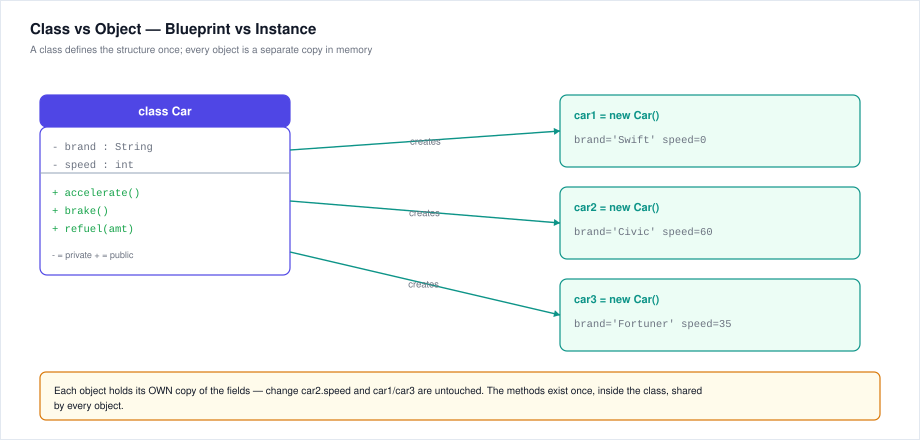
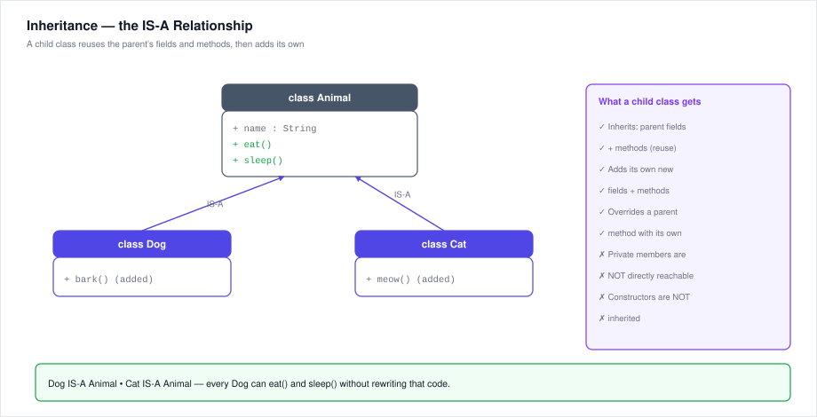
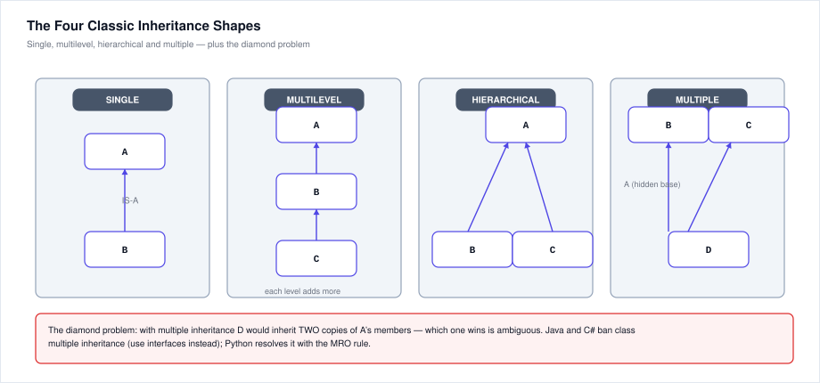
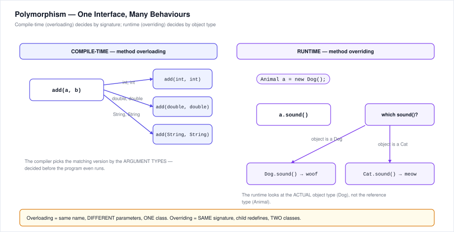

# 14. Object-Oriented Programming (OOPs) — Notes & Questions

OOPs concepts appear in **two places** in the Accenture drive:

1. **Technical MCQ round** — inside the Pseudocode section (≈2–4 questions per drive): class vs object, access modifiers, overloading vs overriding, abstract class vs interface, output tracing of small class programs.
2. **Coding round** — occasionally the DSA problem is best solved by modelling a class (e.g. a `Student` or `BankAccount`), and the frontend part uses OOP-flavoured JS.

This chapter is the **dedicated OOPs notes + question bank** the other chapters only reference (see §7.17, which is just a quick summary of this chapter).

---

## 14.1 The Big Idea — Why OOP Exists

Procedural programming organises code around **functions**; data floats around between them. As programs grow, this becomes fragile: any function can change any data, and adding a feature means hunting through every function.

**Object-Oriented Programming** organises code around **objects** — self-contained bundles of *data* and the *operations* that act on that data.

| Procedural | Object-Oriented |
|---|---|
| Program = list of functions | Program = objects talking to each other |
| Data and functions are separate | Data + methods bundled together |
| Focus: **what to do** | Focus: **on what, and who owns it** |
| Changes ripple across functions | Changes are localised inside a class |

**Real-world analogy:** a car's steering wheel. You don't need to know about the hydraulic fluid, pistons or sensors — you just turn it and the car turns. That is *abstraction* + *encapsulation* in action.

**The four pillars** (you must be able to name and explain all four):

| Pillar | One-line meaning |
|---|---|
| **Encapsulation** | Bundle data + methods; hide the inside, expose a safe outside |
| **Abstraction** | Show only what's needed; hide *how* it works |
| **Inheritance** | A child class reuses and extends a parent class (IS-A) |
| **Polymorphism** | One interface, many behaviours |

---

## 14.2 Classes & Objects

- **Class** = a *blueprint / template*. It defines **fields** (attributes = the data) and **methods** (behaviours = the functions). A class itself occupies **no memory**.
- **Object** = an **instance** of a class, created at runtime. Each object has its **own copy of the fields**, but **shares the class's methods**.
- The verb for making an object is **instantiate** (`new` in Java/C#, `ClassName()` in Python).

```java
// Java — class definition
class Car {
    String brand;     // field (attribute)
    int speed;

    void accelerate() {   // method (behaviour)
        speed = speed + 10;
    }
}

Car c1 = new Car();   // c1 is an OBJECT (instance) of class Car
Car c2 = new Car();   // c2 is a DIFFERENT object with its own fields
```

```python
# Python — same idea
class Car:
    def __init__(self, brand):      # constructor
        self.brand = brand          # self = the object itself
        self.speed = 0

    def accelerate(self):
        self.speed += 10

c1 = Car("Swift")   # c1 and c2 are independent objects
c2 = Car("Civic")
```



**Exam traps:**
- "A class is an object" — **false** in the strict sense (a class is a blueprint; in Java/C# a `Class` object *describes* it, but the blueprint itself isn't an instance of itself).
- "Objects of the same class share field values" — **false**. Each object has its own field copies; only methods are shared.
- `c1` and `c2` above: changing `c2.speed` never affects `c1.speed`.

---

## 14.3 Pillar 1 — Encapsulation (Data Hiding)

**Definition:** wrapping the data (fields) and the code that works on it (methods) into a single unit (class), **and restricting direct outside access** to the internals.

**How it's done:** fields are made `private`; the outside world talks through `public` **getter/setter** methods, where you can add validation.

```java
class BankAccount {
    private double balance;            // hidden from the outside

    public double getBalance() {       // getter — read access
        return balance;
    }

    public void deposit(double amt) {  // setter-like — controlled write
        if (amt > 0) balance += amt;   // validation lives here
    }
}
```

**Why it matters (exam "why" questions):**
1. **Data safety** — nobody can set `balance = -5000` directly; the method enforces rules.
2. **Change-proof** — you can rewrite the internal storage (e.g. store paise instead of rupees) without breaking code that uses the class.
3. **Easier testing/debugging** — all changes funnel through known methods.

**Real-world analogy:** your phone's settings app — you change the screen brightness through a slider (public interface), not by rewiring the display chip (private internals).

**Traps:**
- Encapsulation ≠ just "making fields private" — it's private fields **+ controlled public access**.
- Getter/setter methods are still part of the class's public surface; they are *not* hidden.
- In Python there's no hard `private` — a single underscore `_x` is a convention, `__x` triggers name-mangling. The *idea* is the same.

---

## 14.4 Pillar 2 — Abstraction (Hiding Complexity)

**Definition:** showing only the **essential features** and hiding the **implementation details**.

**Two flavours:**
1. **Data abstraction** — hide *what the data is* (encapsulation supports this).
2. **Procedural abstraction** — hide *how a job is done*. You call `car.start()` without knowing about fuel injection, spark timing, etc.

**Tools for abstraction (Java/C#):**

- **Abstract class** — a class you **cannot instantiate**; it may hold **abstract methods** (declared, no body) that subclasses **must** implement. Use when classes share a *family relationship* and some common code.
- **Interface** — a pure **contract**: method signatures only (Java 8+ allows `default` methods). A class can implement **many** interfaces. Use when unrelated classes must promise the same behaviour.

```java
abstract class Shape {                 // cannot do: new Shape()
    abstract double area();            // no body — subclass MUST implement
    void print() {                     // concrete method — shared code
        System.out.println("Area = " + area());
    }
}

class Circle extends Shape {
    double r;
    double area() { return 3.14159 * r * r; }   // implementation hidden from user
}
```

**Real-world analogy:** driving a car — you know *pressing the pedal accelerates* (interface); you don't need to know the engine's combustion cycle (implementation).

**Traps:**
- Abstraction is about **hiding complexity**, encapsulation is about **hiding data**. Exams love swapping these definitions — remember: *abstraction = hide how, encapsulation = hide what (the data)*.
- An abstract class **can** have constructors, fields, and concrete methods — it's not an interface.

---

## 14.5 Pillar 3 — Inheritance (IS-A)

**Definition:** a class (**child / subclass / derived**) acquires the fields and methods of another class (**parent / superclass / base**), and can add new ones or override existing ones. Keyword: `extends` (Java/C#), `:` (C++), bracket syntax (Python).



**What a child gets:** parent's **public and protected** fields/methods. **What it does NOT get:** `private` members (unreachable directly) and **constructors** (not inherited — the child's constructor calls the parent's via `super()`).

**Types of inheritance:**



| Type | Shape | Example |
|---|---|---|
| **Single** | A → B | `Dog` extends `Animal` |
| **Multilevel** | A → B → C | `Animal` → `Dog` → `Puppy` |
| **Hierarchical** | A → B, A → C | `Animal` → `Dog` and `Cat` |
| **Multiple** | B, C → D | `Bat` extends `Mammal` *and* `Winged` — **not allowed for classes in Java/C#** |
| **Hybrid** | mix of the above | combination of the above |

**The diamond problem:** with multiple inheritance, if B and C both inherit from A, D inherits **two copies** of A's members — ambiguous. Java/C# avoid it by banning class-level multiple inheritance (use **interfaces** instead); Python resolves it with the **MRO** (Method Resolution Order, C3 linearisation).

**Real-world analogy:** a "SalariedEmployee IS-A Employee" — it automatically has `name`, `id`, `calculatePay()` and adds `bonus`.

**Traps:**
- Inheritance is **IS-A**; composition is **HAS-A** (see §14.12). Exams ask which to choose: prefer composition when there's no true IS-A.
- "A subclass can access the parent's private members directly" — **false** (only via public/protected getters).
- "Constructors are inherited" — **false**.

---

## 14.6 Pillar 4 — Polymorphism (Many Forms)

**Definition:** the same message (method call) behaves differently depending on **context**. Two kinds:

| | Compile-time (static) | Runtime (dynamic) |
|---|---|---|
| Also called | **Method overloading** | **Method overriding** |
| Decided by | Compiler, from the **method signature** | Runtime, from the **actual object type** |
| Where | Same class, same name, **different parameters** | Parent + child, **same signature** |
| Also called | Early binding / static dispatch | Late binding / dynamic dispatch |



**Overloading example (one class):**
```java
int add(int a, int b)        { return a + b; }
double add(double a, double b) { return a + b; }   // OK: different params
String add(String a, String b) { return a + b; }   // OK: different params
// int add(int a, int b) { ... }  // ERROR: same signature = redefinition
```

**Overriding example (two classes):**
```java
class Animal { void sound() { System.out.println("..."); } }
class Dog extends Animal {
    @Override
    void sound() { System.out.println("woof"); }   // same signature, new body
}

Animal a = new Dog();   // reference type Animal, OBJECT type Dog
a.sound();              // prints "woof" — runtime picks the OBJECT's type
```

**Key rule for overriding:** the method **signature must be identical**; only the body changes. Return type must be the same or a subtype (covariant). Access can widen (protected → public) but not narrow.

**Traps:**
- Changing **only the return type** is **not** overloading — it's a compile error (same signature).
- `private`, `static` and `final` methods **cannot** be overridden (static methods *hide*, they don't override).
- Constructors can be **overloaded** but never **overridden** (they're not inherited).
- Overriding happens at runtime **only for instance methods**; variables are resolved by reference type.

---

## 14.7 Constructors & Destructors

A **constructor** initialises a freshly created object:
- **Same name as the class**, **no return type** (not even `void`).
- Called **automatically** at object creation; exactly once per object.
- **Default constructor**: if you write none, the compiler supplies a no-arg one (fields get `0` / `null` / `false`).
- **Parameterised constructor**: takes arguments to set initial state.
- **Copy constructor**: creates a new object as a copy of an existing one.
- **Constructor chaining**: `this(...)` calls another constructor in the same class; `super(...)` calls the parent's constructor (must be the **first** statement).

```java
class Student {
    String name;
    int roll;

    Student() { this("Unknown", 0); }              // chaining with this()
    Student(String n, int r) { name = n; roll = r; }  // parameterised
}
```

**Destructor / cleanup:** C++ has `~ClassName()`; Java/C# use garbage collection (no manual destructors — `finalize()`/`Dispose()` exist but are not guaranteed timing). Python has `__del__` but also relies on GC.

**Traps:**
- A constructor with a return type is just a **regular method**, not a constructor.
- If you define *any* constructor, the compiler **no longer adds** the default one.
- Constructors **cannot be** `static`, `final`, `abstract`, or `synchronized`.

---

## 14.8 Access Modifiers & Visibility

| Modifier | Same class | Same package | Subclass (any package) | World |
|---|:---:|:---:|:---:|:---:|
| `private` | ✔ | ✘ | ✘ | ✘ |
| **default** (no keyword) | ✔ | ✔ | ✘ | ✘ |
| `protected` | ✔ | ✔ | ✔ | ✘ |
| `public` | ✔ | ✔ | ✔ | ✔ |

Memory hook: **private < default < protected < public** (each level adds reach).

**Traps:**
- `protected` = package + subclasses — the "subclass anywhere" part is what separates it from default.
- Python has no real modifiers (conventions: `_protected`, `__private`); JavaScript uses `#private` (ES2022+) — know the *concept*, not just the keyword.

---

## 14.9 `static` vs Instance Members

| | Instance | Static |
|---|---|---|
| Belongs to | Each **object** | The **class** itself |
| Memory | One copy per object | One copy total |
| Access | `object.member` | `ClassName.member` (also via object, but discouraged) |
| Can touch | Both instance + static | **Only static** members |
| Keyword | — | `static` |

A `static` method **cannot** use `this`/`self` or instance fields — because no object exists when it runs (`public static void main` is the classic example).

---

## 14.10 Inheritance vs Composition (IS-A vs HAS-A)

- **Inheritance (IS-A):** `Dog extends Animal` — a Dog *is an* Animal. Tight coupling; child inherits everything, even what it shouldn't.
- **Composition (HAS-A):** `Car` has an `Engine` object as a field — looser, more flexible; you can swap the engine at runtime.

**Design rule (frequently asked):** *"Favour composition over inheritance"* — use inheritance only for genuine IS-A relationships; use composition to reuse behaviour.

---

## 14.11 Object Memory & Lifecycle

1. **Declaration** — reference variable created (stack), no object yet.
2. **Instantiation** (`new`) — object built on the **heap**; constructor runs.
3. **Usage** — reference points to the heap object; `null` reference = no object (calling a method on it → `NullPointerException`).
4. **Destruction** — when no references remain, garbage collection reclaims the memory (Java/C#/Python); C++ uses manual `delete` / destructors.

**Stack vs heap:** local variables and references live on the **stack** (fast, auto cleanup); objects themselves live on the **heap** (shared, GC-managed).

**`this` / `self`:** a reference to the **current object** — used to disambiguate fields from parameters (`this.speed = speed`).

---

## 14.12 OOP in Pseudocode — Accenture's Style

Accenture pseudocode questions use class syntax like this:

```
CLASS Rectangle
    PRIVATE length, width
    CONSTRUCTOR(l, w)
        length ← l
        width  ← w
    METHOD area()
        RETURN length * width
END CLASS

r ← NEW Rectangle(5, 4)
PRINT r.area()        // 20
```

**Trace rules:**
- `NEW` runs the constructor **first** — fields get their initial values before any method call.
- Method calls read the **object's current field values** at call time.
- Two objects = two independent field sets, even though the method code is shared.

**Worked trace:**
```
CLASS Counter
    count ← 0
    METHOD inc()
        count ← count + 1
    METHOD get()
        RETURN count
END CLASS

a ← NEW Counter()
b ← NEW Counter()
a.inc(); a.inc()
b.inc()
PRINT a.get() + b.get()
```
`a.count = 2`, `b.count = 1` → output **`3`**. (Common wrong answer: `4` — forgetting each object has its own `count`.)

---

## 14.13 Exam Traps & Trick Patterns (OOP-specific)

1. **"All of the above"** — if two options are true OOP pillars, the third usually is too.
2. **Overload vs override wording** — check "same class" (overload) vs "child class" (override) and "different params" (overload) vs "same signature" (override).
3. **Abstract class instantiation** — always illegal; only subclasses can be instantiated.
4. **Interface instantiation** — also illegal; interfaces have no constructors and (pre-Java-8) no bodies.
5. **`final` keyword** — a `final` class can't be inherited; a `final` method can't be overridden; a `final` variable is a constant.
6. **Reference vs object type** — `Animal a = new Dog(); a.sound()` runs **Dog's** version (object type wins for instance methods).
7. **Constructor return type** — adding one silently turns it into a normal method (a classic trick option).
8. **Multiple inheritance** — allowed in C++ (careful with the diamond), banned for classes in Java/C#, allowed via interfaces; Python allows it with MRO.
9. **`static` method calling instance method** — illegal without an object reference.
10. **Encapsulation ≠ abstraction** — encapsulation hides *data*, abstraction hides *implementation*.

---

## 14.14 Cheat Sheet — Everything on One Screen

| Concept | Key fact |
|---|---|
| Class | Blueprint; no memory; fields + methods |
| Object | Instance of a class; own field copies; made with `new` |
| Encapsulation | Private fields + public getters/setters; data hiding |
| Abstraction | Hide implementation; abstract class / interface |
| Inheritance | `extends` / `:`; IS-A; child gets public + protected |
| Polymorphism | Overload (compile-time) / Override (runtime) |
| Constructor | Same name as class; no return type; auto-called once |
| `private` | same class only |
| `protected` | package + subclasses |
| `public` | everywhere |
| `static` | belongs to class, one copy, no `this` |
| Abstract class | can't instantiate; may have concrete methods |
| Interface | contract of signatures; multiple implementable |
| Composition | HAS-A; favoured over inheritance |

---

# Practice Questions — OOPs MCQs

**(Answers with full explanations at the end)**

### Classes & Objects
1. A class is best described as:
   a) A memory location holding data
   b) A blueprint for creating objects
   c) A keyword that creates an object
   d) A function inside an object
2. How many copies of a class's **methods** exist when 100 objects are created?
   a) 100  b) 1  c) 101  d) Depends on fields
3. Two objects of the same class share:
   a) The same field values  b) The same methods  c) The same memory address  d) Nothing
4. `Animal a = new Animal();` — how many objects and how many references are created?
   a) 2 objects  b) 1 object, 1 reference  c) 1 object, 2 references  d) 0 objects

### Encapsulation & Abstraction
5. Encapsulation is primarily achieved by:
   a) Making all fields public
   b) Making fields private and exposing controlled public methods
   c) Using only static methods
   d) Inheriting from a base class
6. The main benefit of a getter/setter with validation is:
   a) Faster execution
   b) It prevents invalid object state
   c) It reduces code size
   d) It makes fields public
7. Abstraction means:
   a) Hiding data from the user
   b) Hiding implementation complexity, showing only essentials
   c) Reusing code from a parent class
   d) One interface, many forms
8. Which is TRUE of an abstract class?
   a) It can be instantiated with `new`
   b) It cannot have any concrete methods
   c) It cannot be instantiated, but may contain concrete methods
   d) It must have only abstract methods

### Inheritance
9. Inheritance models which relationship?
   a) HAS-A  b) IS-A  c) USES-A  d) PART-OF-A
10. A subclass does **NOT** inherit:
    a) Public methods  b) Protected fields  c) Private fields directly  d) Default methods
11. Which inheritance type is **not** supported for classes in Java?
    a) Single  b) Multilevel  c) Hierarchical  d) Multiple
12. The diamond problem is associated with:
    a) Single inheritance  b) Multiple inheritance  c) Multilevel inheritance  d) Encapsulation
13. Constructors are inherited by subclasses.
    a) True  b) False
14. `super()` in a subclass constructor:
    a) Calls the parent's constructor  b) Creates a new parent object  c) Deletes the parent  d) Calls the parent's `main`

### Polymorphism
15. Method overloading is resolved:
    a) At runtime  b) At compile time  c) Never  d) By the JVM only
16. Which is valid overloading of `void show(int a)`?
    a) `void show(int a, int b)`  b) `int show(int a)`  c) `void Show(int a)`  d) `void show(int a)` with a different body
17. Method overriding requires:
    a) Different parameters  b) Same signature in parent and child  c) Same class  d) Static methods
18. `Animal a = new Dog(); a.sound();` prints "woof". This is:
    a) Overloading  b) Compile-time polymorphism  c) Runtime polymorphism (dynamic dispatch)  d) Encapsulation
19. Which methods CANNOT be overridden?
    a) public  b) protected  c) private and static  d) all can be overridden
20. Changing only the return type of an overloaded method makes it:
    a) Valid overloading  b) A compile error — same signature  c) An override  d) A constructor

### Access Modifiers & Static
21. Correct visibility order (narrowest → widest):
    a) default < private < protected < public
    b) private < default < protected < public
    c) private < protected < default < public
    d) protected < private < default < public
22. `protected` members are accessible in:
    a) Same class only  b) Same package only  c) Same package + subclasses  d) Everywhere
23. A `static` method can directly access:
    a) Instance fields  b) Only static members  c) `this`  d) Nothing at all
24. `static` fields are stored:
    a) Once per object  b) Once per class  c) On the stack  d) Never — they're constants

### Conceptual / Mixed
25. "Favour composition over inheritance" means:
    a) Never use inheritance
    b) Prefer HAS-A (objects as fields) unless there's a true IS-A
    c) Always use interfaces
    d) Inheritance is always better
26. Which is a HAS-A relationship?
    a) `Dog extends Animal`  b) `Car` has an `Engine` field  c) `Cat implements Pet`  d) `Puppy extends Dog`
27. An interface (classic Java, pre-8) contains:
    a) Method bodies  b) Only method signatures (contract)  c) Private fields  d) Constructors
28. A class can implement ______ interface(s) and extend ______ class(es).
    a) one, many  b) many, one  c) one, one  d) many, many
29. `final` on a class means:
    a) Its fields can't change  b) It cannot be subclassed  c) Its methods are static  d) It cannot be instantiated
30. In Python, the constructor method is named:
    a) `__create__`  b) `__init__`  c) `__new__`  d) `constructor`

---

## Answer Key — OOPs MCQs (with explanations)

**Classes & Objects**

1. **b)** A class is a *blueprint/template*. The object is the actual memory-holding instance (a is wrong — that's the object; c describes `new`, not the class; d describes a method).
2. **b) 1** — method code is loaded once per class and shared by all instances; only *fields* are per-object. This is why 1000 objects don't multiply your code size.
3. **b)** — objects share the class's methods but each has its own field values and memory address.
4. **b)** — `new` creates exactly one object; `a` is the one reference pointing at it. (Two references would need a second `=` assignment.)

**Encapsulation & Abstraction**

5. **b)** — encapsulation = private fields + controlled public access methods. Making fields public (a) is the *opposite*.
6. **b)** — validation inside setters/getters blocks illegal states (negative balance, etc.). Speed is unaffected; it may even be marginally slower.
7. **b)** — abstraction hides *how* something works. (a) describes encapsulation; (c) inheritance; (d) polymorphism. Exams swap these four definitions constantly.
8. **c)** — abstract classes can hold concrete methods (shared code); they just can't be instantiated themselves. (b) is false for that reason.

**Inheritance**

9. **b)** — inheritance is the IS-A relationship (Dog IS-A Animal). HAS-A (a) is composition.
10. **c)** — private members are inaccessible to the subclass (reachable only indirectly via the parent's public/protected methods).
11. **d)** — Java bans multiple inheritance *of classes* to avoid the diamond problem; interfaces fill the gap. C++ allows it.
12. **b)** — the diamond: D inherits from B and C, both of which inherit A → ambiguity about which copy of A's members D gets.
13. **b) False** — constructors are never inherited; the subclass constructor invokes the parent's via `super(...)`.
14. **a)** — `super(...)` calls the parent constructor and must be the first statement of the child constructor.

**Polymorphism**

15. **b)** — overloading is compile-time (static) polymorphism; the compiler matches the signature.
16. **a)** — overloading needs a *different parameter list*. (b) differs only in return type → error; (c) differs in *name*, not an overload; (d) is identical → redefinition error.
17. **b)** — overriding = same signature, same method name, in a parent and child, with a new body.
18. **c)** — the *reference* is Animal but the *object* is Dog; at runtime the JVM dispatches to `Dog.sound()`. Classic dynamic dispatch.
19. **c)** — `private` methods aren't visible to subclasses, and `static` methods belong to the class (they're *hidden*, not overridden).
20. **b)** — signature = name + parameter types. Return type isn't part of it, so same-params-different-return is a redefinition error.

**Access Modifiers & Static**

21. **b)** — private < default (package-private) < protected < public.
22. **c)** — protected = package access **plus** subclass access anywhere.
23. **b)** — static methods belong to the class, not an object, so they can only touch static members directly (no `this` exists).
24. **b)** — one copy per class, stored in the class area; every object shares it (handy for counters/constants).

**Conceptual / Mixed**

25. **b)** — composition gives looser coupling and runtime flexibility; keep inheritance for genuine IS-A.
26. **b)** — Car *has an* Engine (composition). (a) and (d) are IS-A; (c) is an interface implementation (also a kind of IS-A).
27. **b)** — a classic interface is a pure contract: signatures only, no bodies, no constructors. (Java 8+ added `default` methods, but the exam answer remains "contract".)
28. **b)** — many interfaces, one class: Java/C# single inheritance for classes, multiple for interfaces.
29. **b)** — a `final` class has no subclasses. (`final` on a variable makes it a constant; on a method, non-overridable.)
30. **b)** — `__init__(self, ...)` initialises the object; `__new__` is the allocator (rarely overridden).

---

## 14.15 Coding-Style Practice (write it yourself first)

**P1 — Model a `Student`:** fields `name`, `roll`, `marks` (private); constructor; `getAverage()` if three subjects stored; a `display()` printing name + average. *Check: fields private, constructor parameterised, no `static` leakage.*

**P2 — Inheritance chain:** `class Vehicle` (fields `make`, `speed`; method `describe()`), `class Car extends Vehicle` (field `doors`, override `describe()` to include doors), `class ElectricCar extends Car` (field `batteryKwh`, override again). Create one `ElectricCar` and call `describe()` — which version runs? *(Answer: the most-derived override — ElectricCar's — because dispatch follows the object type.)*

**P3 — Overload practice:** write class `Calculator` with `add(int,int)`, `add(double,double)`, `add(String,String)` and predict the output of `add(2,3)`, `add(2.5,3.0)`, `add("2","3")`. *(Answer: `5`, `5.5`, `"23"` — the String overload concatenates.)*

**P4 — Abstract design:** abstract `class Shape` with abstract `area()` and concrete `printArea()`. Subclasses `Circle` and `Square`. Why can't you write `new Shape()`? *(Answer: Shape is incomplete — `area()` has no body; only concrete subclasses can be instantiated.)*

**P5 — Static counter:** class `Employee` with a `static int count` incremented in every constructor and a `static int total()` returning it. Create 5 employees — what does `total()` return? *(Answer: 5 — static fields are shared once per class.)*

---

> **Next:** [15 - OS Fundamentals](./15-os-fundamentals.md). **Previous:** [13 - Mock Paper 4 (Coding)](./13-mock-paper-4-full-coding-round.md). For the one-paragraph summary, see [§7.17 in the deep-dives chapter](./07-deep-dives-tricky-topics.md#717-oop-concepts-quick-reference-sometimes-tested-in-pseudocode-section).
