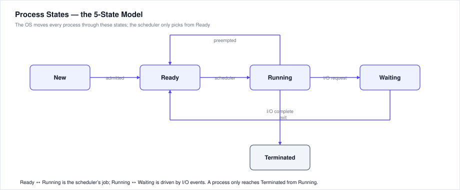
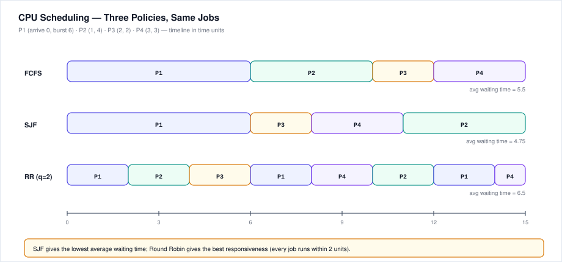
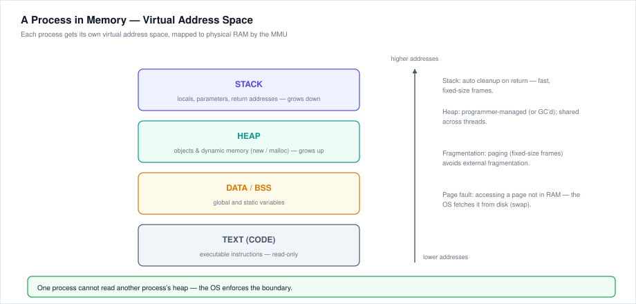

# 15. OS Fundamentals — Notes & Questions

Operating-system questions appear in the Accenture technical MCQ round (usually inside the Networking/CS-core bucket) and occasionally as pseudocode-adjacent reasoning ("what does the scheduler do next?"). This chapter covers the descriptive fundamentals + the numerical bits (turnaround/waiting time) that exams love.

---

## 15.1 What an Operating System Is

An OS is the **resource manager** and **abstraction layer** between hardware and applications.

**Core jobs:**
1. **Process management** — create, schedule, suspend, terminate processes
2. **Memory management** — allocate/free RAM, enforce protection between processes
3. **File system** — organise persistent storage into files/directories
4. **I/O management** — drivers, buffering, device sharing
5. **Security & protection** — user/auth, access control, user vs kernel mode

**The two CPU modes (frequently asked):**
- **User mode** — apps run here; they cannot touch hardware directly.
- **Kernel mode** — the OS kernel runs here with full hardware access.
- Switching happens via a **system call** (or an interrupt). A program asks the OS to do privileged work *for* it.

**Real-world analogy:** the OS is the restaurant manager — waiters (applications) never enter the kitchen (hardware) themselves; they place orders (system calls) and the manager routes the work.

---

## 15.2 Processes, Programs & Threads

- **Program** = passive file on disk (instructions).
- **Process** = a program **in execution** — has a PCB (Process Control Block: PID, state, PC, registers, memory map), its own address space.
- **Thread** = a lightweight execution unit *inside* a process. Threads of a process **share** code, data and files, but each has its own stack, PC and registers.

| | Process | Thread |
|---|---|---|
| Memory | Own address space | Shares the process's space |
| Creation cost | Heavy | Light ("lightweight process") |
| Communication | IPC (pipes, sockets, shared memory) | Direct (shared variables) |
| Crash impact | Isolated — other processes survive | Can take down the whole process |

**Multithreading** = multiple threads in one process (UI stays responsive while a background thread downloads). **Multiprocessing** = multiple CPUs; **multitasking** = multiple processes sharing one CPU via time-slicing.

**Process states:** New → **Ready** → **Running** → (Waiting → Ready) → Terminated. The scheduler only ever picks from the **Ready** queue; a running process gives up the CPU voluntarily (time slice over, I/O wait) or by exiting.

**Context switch:** saving one process's state (PCB) and loading another's — pure overhead, so the OS wants switches infrequent but fair.

**Traps:**
- "A process and a program are the same" — **false**; a program is static, a process is dynamic.
- "Threads have separate memory" — **false**; only stacks and registers are private.
- Coroutine ≠ thread; a coroutine is user-space cooperative scheduling (Python `asyncio`), not OS-scheduled.

---

## 15.3 CPU Scheduling

**Why:** many ready processes, one CPU — the scheduler decides who runs next to optimise:

| Criterion | Meaning |
|---|---|
| CPU utilisation | keep the CPU busy (%) |
| Throughput | processes completed per unit time |
| Turnaround time | completion − arrival (whole sojourn) |
| Waiting time | turnaround − burst (time in ready queue) |
| Response time | first response − arrival (interactive feel) |

**Algorithms:**

| Algorithm | Rule | Notes |
|---|---|---|
| **FCFS** | first come, first served | simple; convoy effect (short jobs stuck behind a long one) |
| **SJF** (shortest job first) | pick smallest burst | optimal average waiting time; needs burst prediction |
| **Priority** | pick highest priority | starvation risk → use **aging** (raise priority of waiting jobs) |
| **Round Robin** | each job gets a time quantum *q* | fair, responsive; too small *q* ⇒ too many context switches |
| **Multilevel queue** | separate queues (system, interactive, batch) | each queue has its own policy |
| **Multilevel feedback queue** | jobs move between queues | the most general; used by real OSes |

**Preemptive vs non-preemptive:** FCFS/SJF are usually non-preemptive; RR and priority are preemptive (the OS can yank the CPU back).

**Worked example** (jobs P1–P4, arrival 0/1/2/3, burst 6/4/2/3):

- **FCFS:** P1(0–6) P2(6–10) P3(10–12) P4(12–15) → waits 0, 5, 8, 9 → **avg 5.5**
- **SJF:** P1(0–6) P3(6–8) P4(8–11) P2(11–15) → waits 0, 10, 4, 5 → **avg 4.75** ← best
- **RR (q=2):** P1 P2 P3 P1 P4 P2 P1 P4 → waits 8, 7, 2, 9 → **avg 6.5** ← most responsive

**Traps:**
- SJF is optimal for *average waiting time*, not for *maximum* waiting time (a long job can starve).
- Round Robin's quantum matters: q = ∞ behaves like FCFS; q too small wastes time on context switches.
- Turnaround = waiting + burst. Exams ask you to compute one from the other.

---

## 15.4 Memory Management

**Layout (high → low addresses):** Stack (locals, call frames, grows down) · Heap (dynamic allocation, grows up) · Data/BSS (globals/statics) · Text (code, read-only).

**Key ideas:**
- **Virtual memory** — every process sees a full private address space; the MMU + page tables translate virtual → physical addresses. Lets RAM hold more than physically exists by paging to disk (**swap**).
- **Paging** — memory split into fixed-size **frames**; a process's pages map to any frames. No external fragmentation; possible **internal** fragmentation (last page partly empty).
- **Segmentation** — variable-size logical segments (code, data, stack); can cause external fragmentation.
- **Page fault** — access to a page not in RAM → OS fetches it from disk (slow, ~ms vs ~ns for RAM).
- **TLB** — cache of recent page-table entries; hits make translation nearly free.
- **Thrashing** — spending more time paging than executing; caused by too many processes or too little RAM.

**Fragmentation:** *external* = free memory is scattered in small holes (fixed by compaction/paging); *internal* = allocated blocks are bigger than needed (fixed-size frames).

**Traps:**
- "Virtual memory increases RAM" — no, it *extends the effective address space* using disk; it's slower when it thrashes.
- Heap is shared by all threads of a process; each thread gets its own stack.
- `malloc`/`new` allocate on the **heap**; local variables live on the **stack**.

---

## 15.5 File Systems

- Files are byte sequences organised in a **directory tree** (hierarchical).
- On disk, files occupy **blocks**; metadata (name, size, block pointers, permissions) lives in an **inode** (Unix/ext4) or **FAT** entry (FAT32) or **MFT** record (NTFS).
- **Common systems:** ext4 (Linux), NTFS (Windows), APFS (macOS), FAT32 (USB sticks).
- **Permissions (Unix rwx):** read(4) + write(2) + execute(1); `rwxr-xr--` = 754 (owner / group / others).
- **Path types:** absolute (from root `/` or `C:\`) vs relative (from cwd).

**Traps:**
- Deleting a file removes its directory entry; the blocks are marked free — data often recoverable until overwritten.
- A hard link shares the same inode; a symbolic (soft) link is a pointer to a *path*.

---

## 15.6 Concurrency & Synchronization

**Race condition:** two+ threads access shared data concurrently and the result depends on timing. **Critical section** = the code touching shared data; only one thread may be in it at a time (**mutual exclusion**).

**Tools:**
- **Mutex (lock)** — binary; one owner at a time; `lock()` / `unlock()`.
- **Semaphore** — counter; allows *N* concurrent entries (`wait`/`signal`, aka P/V).
- **Monitor** — language-level wrapper (Java `synchronized`).
- **Spinlock** — busy-waits; fine for very short waits.

**Deadlock** — two+ processes each hold a resource the other needs, forever. Four **necessary conditions** (all must hold):
1. **Mutual exclusion** — resource is non-shareable
2. **Hold and wait** — holding one, waiting for another
3. **No preemption** — resources can't be forcibly taken
4. **Circular wait** — a cycle of processes each waiting on the next

**Handling:** *prevention* (break one condition, e.g. request all resources at once), *avoidance* (Banker's algorithm — check safety before granting), *detection & recovery* (kill/rollback a process).

**Starvation:** a process waits forever while others proceed (e.g., low-priority jobs) — fixed by **aging**.

**Traps:**
- Deadlock requires **all four** conditions — removing any one prevents it.
- Mutex = semaphore with count 1, but semantics differ (ownership).
- Deadlock ≠ livelock (processes keep moving but make no progress) ≠ starvation.

---

## 15.7 I/O & Interrupts

- **Interrupt** — hardware signals the CPU that an event (keypress, disk done) needs attention; the CPU saves state and runs an **interrupt handler (ISR)**.
- **Polling** — CPU repeatedly checks the device (wasteful) vs **interrupt-driven I/O** (device notifies when ready).
- **DMA** — disk↔RAM transfers bypass the CPU; the CPU is free during the copy.
- **Buffering** — a memory area smoothing speed differences between producer and consumer (keyboard buffer, print spooler).

**Traps:**
- Interrupts make I/O efficient — without them the CPU would spin doing nothing.
- The kernel, not the application, talks to device drivers.

---

## 15.8 Kernel & System Calls

- **Monolithic kernel** — all OS services in one big kernel (Linux) — fast, larger attack surface.
- **Microkernel** — minimal kernel (IPC, scheduling); other services run in user space (QNX, Minix) — safer, more IPC overhead.
- **Hybrid** — Windows NT / macOS (Mach + BSD layers).
- **System call** = the API into the kernel: `read`, `write`, `open`, `fork`, `exec`, `wait`, `mmap`.

**Exam hook:** "Where does `fork()` run?" — it's a system call: the program traps into kernel mode, the kernel creates the child process.

---

## 15.9 Exam Traps — OS Edition

1. **Turnaround vs waiting** — waiting = turnaround − burst; don't confuse them.
2. **SJF optimises average waiting time**, not worst-case response.
3. **Paging kills external fragmentation**, not internal.
4. **Threads share the heap** — that's why you need locks.
5. **Page fault ≠ error** — it's a normal event; the OS handles it.
6. **Deadlock needs all four conditions**; breaking any one prevents it.
7. **Kernel mode ≠ admin/root user** — it's a CPU privilege level, not an account.
8. **Fork duplicates the process** (parent + child); `exec` replaces the image.
9. **Swap vs page file** — same idea, different OS naming (Linux swap, Windows pagefile).
10. **Interrupts are asynchronous** — they can arrive between any two instructions.

---

## 15.10 Cheat Sheet

| Term | One-liner |
|---|---|
| Process | program in execution; own memory + PCB |
| Thread | lightweight unit inside a process; shares memory |
| PCB | process state: PID, PC, registers, memory map |
| Context switch | save/load PCBs — scheduling overhead |
| FCFS / SJF / RR / Priority | the four classic scheduling policies |
| Turnaround | completion − arrival |
| Waiting | turnaround − burst |
| Page fault | access to a page not in RAM → disk fetch |
| TLB | cache of page-table translations |
| Thrashing | paging dominates execution |
| Mutex / Semaphore | 1-owner lock / counter-based gate |
| Deadlock | mutual exclusion + hold&wait + no preemption + circular wait |
| System call | user → kernel mode request (read, write, fork) |

---

# Practice Questions — OS Fundamentals MCQs

**(Answers with full explanations at the end)**

### Basics & Processes
1. Which is NOT a main function of an OS?
   a) Process management  b) Memory management  c) Compiling source code  d) File management
2. A program becomes a process when it is:
   a) Saved to disk  b) Loaded into memory and executed  c) Written  d) Compiled
3. Which is TRUE about threads?
   a) Each thread has its own heap
   b) Threads of a process share code and data
   c) Threads cannot run concurrently
   d) A thread is heavier than a process
4. The PCB does NOT contain:
   a) Process ID  b) Program counter  c) The program's source code  d) Register values
5. A context switch is:
   a) Changing the CPU hardware  b) Saving one process's state and loading another's  c) Deleting a process  d) Swapping disks

### Scheduling
6. The convoy effect occurs in:
   a) SJF  b) FCFS  c) Round Robin  d) Priority
7. Which algorithm gives the minimum average waiting time (non-preemptive)?
   a) FCFS  b) SJF  c) Round Robin  d) Priority
8. In Round Robin, a very small quantum causes:
   a) Starvation  b) Too many context switches  c) Deadlock  d) No change
9. Aging is used to prevent:
   a) Deadlock  b) Starvation  c) Thrashing  d) Fragmentation
10. Jobs P1(0,6) P2(1,4) P3(2,2) P4(3,3) — under FCFS, P3's waiting time is:
    a) 2  b) 4  c) 8  d) 10

### Memory
11. Virtual memory's main benefit is:
   a) Faster CPU  b) Running programs larger than physical RAM  c) Removing the need for disk  d) Fewer processes
12. A page fault happens when:
   a) A program divides by zero  b) A page is referenced but not in RAM  c) The disk is full  d) Two processes collide
13. Paging eliminates:
   a) Internal fragmentation  b) External fragmentation  c) Both  d) Neither
14. The TLB caches:
   a) Disk blocks  b) Recent page-table translations  c) File metadata  d) Register values
15. Thrashing means:
   a) The CPU is 100% busy  b) The system spends more time paging than executing  c) A deadlocked process  d) A full disk

### Files & Concurrency
16. In Unix permissions `rwxr-xr--`, the group's permission is:
   a) 7  b) 5  c) 4  d) 2
17. An inode stores:
   a) The file's name only  b) Metadata and block pointers of a file  c) The file's data  d) The directory tree
18. A critical section is:
   a) A deadlock  b) Code that accesses shared data  c) A kernel module  d) A CPU burst
19. Which is NOT a necessary condition for deadlock?
   a) Mutual exclusion  b) Hold and wait  c) Preemption  d) Circular wait
20. A semaphore with count 1 behaves like:
   a) A queue  b) A mutex  c) A thread pool  d) A pipe

### Mixed
21. User mode → kernel mode transition happens via:
   a) Function call  b) System call / interrupt  c) Thread creation  d) Garbage collection
22. `fork()` creates:
   a) A new thread  b) A new process (copy of the caller)  c) A new file  d) A new user
23. Which scheduling policy is preemptive?
   a) FCFS  b) SJF (classic)  c) Round Robin  d) FCFS with priority
24. A spooler is used for:
   a) Memory allocation  b) Overlapping I/O with computation (e.g. print queue)  c) Deadlock detection  d) File encryption
25. Microkernel architecture means:
   a) All services run in kernel mode
   b) Only essential services run in the kernel; others run in user space
   c) The kernel has no memory
   d) No system calls exist

---

## Answer Key — OS MCQs (with explanations)

**Basics & Processes**

1. **c)** — Compilation is a compiler's job; the OS manages processes, memory, files and I/O.
2. **b)** — A process is a program loaded into memory and executing, with its own PCB and address space.
3. **b)** — Threads share the process's code, data and heap; each has its own stack/registers. (a) is backwards — the heap is shared, which is exactly why locks are needed.
4. **c)** — The PCB holds *state* (PID, PC, registers, memory map), not the source text.
5. **b)** — A context switch saves the outgoing process's state and restores the incoming one; it's pure overhead.

**Scheduling**

6. **b)** — FCFS lets one long job hold the CPU while short jobs wait behind it (the convoy effect).
7. **b)** — SJF is provably optimal for average waiting time (non-preemptive version); its weakness is predicting the next burst.
8. **b)** — Tiny quanta mean the dispatcher runs almost constantly; throughput falls even though responsiveness looks good.
9. **b)** — Aging gradually raises the priority of long-waiting jobs so they eventually run (kills starvation).
10. **c)** — FCFS order P1(0–6) P2(6–10) P3(10–12): P3 arrives at 2 and starts at 10 → waiting = 10 − 2 = **8**.

**Memory**

11. **b)** — Virtual memory lets the address space exceed physical RAM by paging to disk (at a speed cost).
12. **b)** — A page fault is a normal event: the referenced page isn't in RAM, so the OS fetches it from swap/disk.
13. **b)** — Fixed-size pages can be placed anywhere, so no external holes; internal waste (partial last page) remains.
14. **b)** — The TLB is a small, fast cache of recent virtual→physical translations.
15. **b)** — Thrashing = the system spends more time swapping pages than doing useful work; add RAM or run fewer processes.

**Files & Concurrency**

16. **b)** — `r-x` = 4 + 0 + 1 = **5**. (Owner is 7, others are 4.)
17. **b)** — The inode holds metadata (size, times, permissions) and the block pointers; the *name* lives in the directory entry.
18. **b)** — The critical section is the shared-data access code; only one thread may execute it at a time.
19. **c)** — Deadlock needs mutual exclusion, hold-and-wait, **no** preemption, and circular wait. Allowing preemption *breaks* deadlock, so it can't be a requirement.
20. **b)** — A counting semaphore of 1 allows exactly one holder at a time, which is mutex behaviour (modulo ownership semantics).

**Mixed**

21. **b)** — System calls and hardware interrupts trap from user mode into kernel mode.
22. **b)** — `fork()` duplicates the calling process (child gets a copy of the address space); `exec` then replaces it with a new program.
23. **c)** — Round Robin preempts after each quantum; classic FCFS/SJF let a job keep the CPU until it blocks or finishes.
24. **b)** — Spooling (e.g. print spooler) queues I/O work so the CPU and devices overlap.
25. **b)** — Microkernels keep only scheduling, IPC and memory basics in the kernel; drivers/file systems run as user-space services (safer, some IPC cost).

---

> **Next:** [16 - Java Basics](./16-java-basics.md). **Previous:** [14 - OOPs](./14-oop-object-oriented-programming.md).
