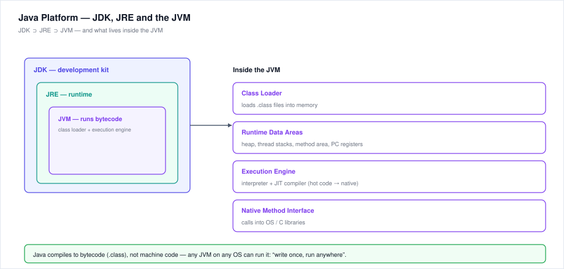
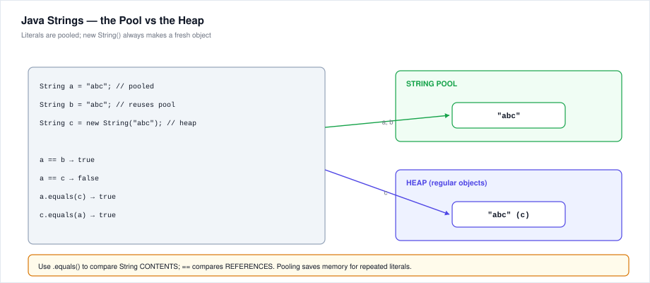
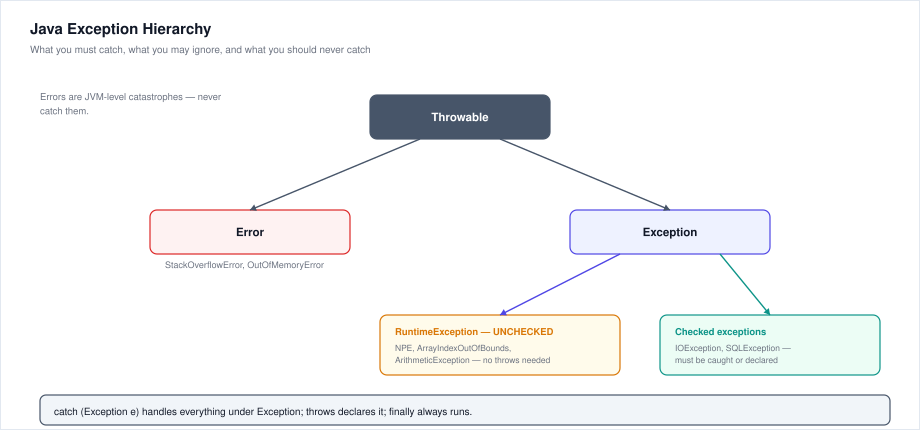

# 16. Java Basics — Notes & Questions

Java is the most common *real language* behind Accenture's coding round (many drives let you choose Java), and Java-flavoured MCQs (output prediction, `==` vs `equals`, autoboxing, exceptions) show up in the technical section. This chapter is a descriptive foundation — everything you need before the coding round.

---

## 16.1 Java at a Glance

- **Object-oriented** (classes, objects — see [chapter 14](./14-oop-object-oriented-programming.md)), **platform-independent**, **strongly typed**.
- Source (`.java`) → compiler `javac` → **bytecode** (`.class`) → JVM executes it.
- **"Write once, run anywhere"** — bytecode runs on any OS that has a JVM.

| Piece | What it is |
|---|---|
| **JDK** | Java Development Kit — compiler (`javac`), `java` launcher, libraries; what developers install |
| **JRE** | Java Runtime Environment — JVM + core libraries; what end-users install to *run* apps |
| **JVM** | Java Virtual Machine — loads, verifies and executes bytecode; does memory management (GC) |

Nesting: **JDK ⊃ JRE ⊃ JVM**.



**Inside the JVM:**
1. **Class Loader** — loads `.class` files (load → link → initialise).
2. **Runtime Data Areas** — heap (objects), thread stacks (locals), method area (class metadata), PC registers.
3. **Execution Engine** — interpreter + **JIT compiler** (hot bytecode compiled to native code on the fly).
4. **Native Method Interface** — bridges to OS/C libraries.

**First program:**
```java
public class HelloWorld {          // file must be named HelloWorld.java
    public static void main(String[] args) {   // entry point
        System.out.println("Hello, World!");   // println adds a newline
    }
}
```
```bash
javac HelloWorld.java   # produces HelloWorld.class (bytecode)
java HelloWorld         # runs it (no .class extension!)
```

**Traps:**
- A `public` class must match its filename exactly.
- `java HelloWorld` — **no** `.class` extension on the command line.
- `main` must be `public static void main(String[] args)` — any deviation and the JVM won't find the entry point.

---

## 16.2 Data Types & Variables

**Primitives (8):**

| Type | Size | Default | Wrapper |
|---|---|---|---|
| `byte` | 8 bit | 0 | `Byte` |
| `short` | 16 bit | 0 | `Short` |
| `int` | 32 bit | 0 | `Integer` |
| `long` | 64 bit | 0L | `Long` |
| `float` | 32 bit | 0.0f | `Float` |
| `double` | 64 bit | 0.0d | `Double` |
| `char` | 16 bit (Unicode) | `'\u0000'` | `Character` |
| `boolean` | 1 bit (logically) | `false` | `Boolean` |

**Reference types** — objects, arrays, `String` (default value `null`).

```java
int age = 25;                 // local variable MUST be initialised
double pi = 3.14159;
char grade = 'A';
boolean ok = true;
String name = "Ravi";         // reference type
long big = 10000000000L;      // L suffix = long literal
float f = 2.5f;               // f suffix = float literal
```

**Casting:** `int i = (int) 3.9;` → 3 (truncates). Widening (int → long → double) is automatic; narrowing needs an explicit cast.

**Traps:**
- `float f = 3.0;` **fails** — `3.0` is a `double`; write `3.0f`.
- Integer division: `7 / 2` = **3**, not 3.5. `7 / 2.0` = 3.5.
- `char` is numeric under the hood: `'A' + 1` = `'B'` (66).
- `null` is only for reference types; primitives can't be null (use wrappers).

---

## 16.3 Operators

| Category | Operators |
|---|---|
| Arithmetic | `+ - * / %` |
| Relational | `< > <= >= == !=` |
| Logical | `&& \|\| !` (short-circuit) |
| Bitwise | `& \| ^ ~ << >> >>>` |
| Assignment | `= += -= *= /=` |
| Ternary | `cond ? a : b` |
| Increment | `++ --` (prefix vs postfix) |

```java
int a = 5;
int b = a++;   // b = 5, then a becomes 6  (postfix: use, then increment)
int c = ++a;   // a becomes 7, then c = 7  (prefix: increment, then use)
```

**Shifts:** `8 << 1` = 16 (multiply by 2), `8 >> 1` = 2 (signed divide by 2), `>>>` shifts in zeros (unsigned).

**String `+` concatenates:** `"Score: " + 5 + 3` → `"Score: 53"` (left-to-right!), but `5 + 3 + "!"` → `"8!"`.

**Traps:**
- `&&`/`||` short-circuit: `false && x++` never runs `x++`.
- `==` on objects compares **references**, not contents (see §16.5).
- `%` keeps the sign of the dividend: `-7 % 3` = `-1`.

---

## 16.4 Control Flow

```java
if (score >= 90)      grade = 'A';
else if (score >= 75) grade = 'B';
else                  grade = 'C';

switch (day) {        // int, char, String (Java 7+), enums
    case 1:  System.out.println("Mon"); break;   // break stops fall-through
    case 2:  System.out.println("Tue"); break;
    default: System.out.println("Other");
}

for (int i = 0; i < n; i++) { ... }     // counted loop
while (cond) { ... }                    // test-first
do { ... } while (cond);                // test-last (runs at least once)

break;      // exits the innermost loop/switch
continue;   // skips to the next iteration
return;     // exits the method
```

**Traps:**
- Missing `break` in `switch` → **fall-through** to the next case (a classic output-prediction trap).
- `while (cond);` with a stray semicolon = empty body, possible infinite loop.
- `for (int i = 0; i < 5; i++)` runs **5** times (i = 0..4) — off-by-one is the #1 coding-round bug.

---

## 16.5 Arrays & Strings

**Arrays** — fixed-size, same-type, 0-based:
```java
int[] nums = new int[5];            // defaults to all 0
String[] names = {"Ada", "Linus"};  // length = 2
nums[0] = 10;                       // index out of bounds → ArrayIndexOutOfBoundsException
System.out.println(nums.length);    // 5 (field, not a method!)
```

**Strings are immutable** — every "modification" creates a new String object:



- **String pool** — literals with the same content share one object (`a == b` is `true` for identical literals).
- `new String("abc")` — always a **fresh heap object** (`a == c` is `false`).
- **Always compare contents with `.equals()`** — `==` compares references.

**Common methods:** `length()`, `charAt(i)`, `substring(b, e)`, `indexOf()`, `contains()`, `toUpperCase()`, `trim()`, `split(",")`, `equals()`, `compareTo()`.

**Mutable alternatives:** `StringBuilder` (fast, not thread-safe) / `StringBuffer` (slower, thread-safe) — use them in loops instead of `+` concatenation.

**Traps:**
- `"abc" == "abc"` → true (pooled); `new String("abc") == "abc"` → false (heap vs pool).
- `String` has `length()` (method); arrays have `length` (field). Exams mix these.
- `substring(1, 4)` is inclusive of 1, exclusive of 4.

---

## 16.6 OOP in Java (quick map)

Full theory in [chapter 14](./14-oop-object-oriented-programming.md). Java-specific essentials:

```java
class Animal {
    private String name;                 // encapsulation
    Animal(String name) { this.name = name; }   // constructor
    String speak() { return "..."; }
}

class Dog extends Animal {               // inheritance (IS-A)
    Dog(String n) { super(n); }          // super() = parent constructor
    @Override String speak() { return "woof"; }   // overriding
    void fetch(int x) { }                // overloading = same name, different params
}

interface Pet { void play(); }           // contract; a class can implement many
class Puppy extends Dog implements Pet {
    public void play() { System.out.println("fetch!"); }
}
```

- `final` — class can't be subclassed, method can't be overridden, variable is a constant.
- `abstract` — incomplete class; cannot `new` it; subclasses implement its abstract methods.
- `static` — belongs to the class, not objects (`Math.max(...)` is static).
- `this` — the current object; `super` — the parent.

---

## 16.7 Exception Handling



- **Checked exceptions** (`IOException`, `SQLException`) — the compiler **forces** you to catch or declare (`throws`).
- **Unchecked** (`RuntimeException` subclasses: `NullPointerException`, `ArrayIndexOutOfBoundsException`, `ArithmeticException`) — compiler doesn't force handling; they're usually **bugs**.
- **Errors** (`StackOverflowError`, `OutOfMemoryError`) — JVM-level catastrophes; **never catch**.

```java
try {
    int x = 10 / 0;                    // ArithmeticException
} catch (ArithmeticException e) {
    System.out.println("No division by zero");
} finally {                            // ALWAYS runs (even with return)
    System.out.println("cleanup");
}

void read() throws IOException { ... } // declare instead of catching
```

**Rules:** `try` needs `catch` or `finally`; multiple `catch` blocks go specific → general; `finally` runs even when an exception escapes.

**Traps:**
- `return` inside `try` still runs `finally` first.
- Catching `Exception e` grabs *everything* under Exception — too broad for real code, handy in exams.
- A method overriding another may only throw the same or narrower exceptions.

---

## 16.8 Collections ( essentials)

| Interface | Common class | Ordered? | Duplicates? | Notes |
|---|---|---|---|---|
| `List` | `ArrayList` | ✔ | ✔ | fast random access |
| `List` | `LinkedList` | ✔ | ✔ | fast insert/delete |
| `Set` | `HashSet` | ✘ | ✘ | no order, no duplicates |
| `Set` | `TreeSet` | sorted | ✘ | natural ordering |
| `Map` | `HashMap` | ✘ | keys ✘ | key → value |
| `Map` | `TreeMap` | sorted keys | keys ✘ | |

```java
List<String> list = new ArrayList<>();   // List is the interface
list.add("a"); list.get(0); list.size();

Map<String, Integer> map = new HashMap<>();
map.put("Ravi", 25);
map.get("Ravi");                          // 25
map.containsKey("Ravi");                  // true

list.sort(null);                          // natural order
Collections.sort(list);                   // or this
```

**Traps:**
- `List` allows duplicates; `Set` silently drops them.
- `HashMap` order is **not** guaranteed — use `LinkedHashMap` (insertion order) or `TreeMap` (sorted) if order matters.
- Generics need reference types: `List<int>` is illegal — use `List<Integer>` (autoboxing).

---

## 16.9 Java-Specific Exam Traps

1. **Pass-by-value, always** — even objects: the *reference* is copied, so method changes to the object's fields persist, but reassigning the parameter doesn't affect the caller.
2. **`==` vs `.equals()`** — `==` is reference identity; `.equals()` compares contents (Strings!).
3. **Autoboxing** — `Integer i = 10;` boxes; `int j = i;` unboxes. `Integer a = 1000, b = 1000; a == b` → **false** (cache only covers −128..127!).
4. **String pool** — literals are pooled, `new String()` is not.
5. **`final`** — variable = constant, method = non-overridable, class = non-inheritable.
6. **`static`** — one copy per class; can't touch instance fields from a static method.
7. **`main` is static** — the JVM calls it without creating an object.
8. **Overload resolution** — exact match first, then widening, then boxing, then varargs (see hard-mock Q29).
9. **Array `length`** is a field; `String.length()` is a method.
10. **Integer division** — `7 / 2` = 3; cast first if you need 3.5.

---

## 16.10 Cheat Sheet

| Concept | Key fact |
|---|---|
| `javac` | source → bytecode (`.class`) |
| `java` | runs bytecode on the JVM |
| JDK ⊃ JRE ⊃ JVM | dev kit contains runtime contains VM |
| 8 primitives | byte short int long float double char boolean |
| `int` default | `0`; reference default `null` |
| `main` signature | `public static void main(String[] args)` |
| Strings | immutable; literals pooled; compare with `.equals()` |
| `==` | reference equality (contents for primitives) |
| checked vs unchecked | compiler-forced vs runtime bugs |
| `finally` | always runs |
| Collections | List (ordered, dupes), Set (unique), Map (key→value) |

---

# Practice Questions — Java Basics MCQs

**(Answers with full explanations at the end)**

### Platform & Structure
1. Java achieves platform independence through:
   a) Machine code  b) Bytecode run on the JVM  c) HTML  d) Assembly
2. Which command compiles `App.java`?
   a) `java App.java`  b) `javac App.java`  c) `run App`  d) `compile App.java`
3. The JVM is contained in:
   a) The JDK only  b) The JRE  c) The browser  d) The CPU
4. The entry point of a Java application is:
   a) `public void main()`  b) `public static void main(String[] args)`  c) `void start()`  d) `public static int main()`

### Types & Operators
5. Default value of an instance `int` field is:
   a) null  b) 0  c) 1  d) undefined
6. `float f = 3.0;` fails to compile because:
   a) `float` is invalid  b) `3.0` is a `double` — needs `f` suffix or cast  c) floats can't be 3.0  d) missing semicolon
7. `7 / 2` and `7 % 2` give:
   a) 3.5 and 1  b) 3 and 1  c) 3 and 0  d) 4 and 1
8. `"Score: " + 5 + 3` prints:
   a) Score: 8  b) Score: 53  c) Score: 5 3  d) Compile error
9. After `int a = 5; int b = a++;`:
   a) a=5, b=5  b) a=6, b=5  c) a=6, b=6  d) a=5, b=6

### Control Flow
10. A `switch` without `break` causes:
    a) Compile error  b) Fall-through to the next case  c) Infinite loop  d) Nothing
11. `do { ... } while (cond);` executes the body:
    a) Never if cond is false  b) At least once  c) Exactly once  d) Only when cond is true initially

### Strings & Arrays
12. `String a = "abc"; String b = "abc"; a == b` is:
    a) false  b) true  c) compile error  d) runtime exception
13. The correct way to compare String contents is:
    a) `==`  b) `.equals()`  c) `=`  d) `.compare()`
14. `"abcdef".substring(1, 4)` returns:
    a) "abc"  b) "bcd"  c) "bcde"  d) "bcd"
15. An array's size is accessed via:
    a) `arr.length()`  b) `arr.length`  c) `arr.size()`  d) `len(arr)`
16. `new String("abc") == "abc"` is:
    a) true  b) false  c) sometimes  d) compile error

### OOP & Exceptions
17. A constructor must:
    a) Return void  b) Have the class name and no return type  c) Be static  d) Be private
18. Which can be inherited?
    a) Constructors  b) Private fields directly  c) Public methods  d) None
19. `static` methods can directly access:
    a) Instance fields  b) Only static members  c) `this`  d) Everything
20. Checked exceptions must be:
    a) Ignored  b) Caught or declared with `throws`  c) Always fatal  d) Caught in `main` only
21. `finally` blocks run:
    a) Only if no exception  b) Always (whether or not an exception occurred)  c) Only on error  d) Never with return
22. Which is an UNCHECKED exception?
    a) IOException  b) SQLException  c) NullPointerException  d) ClassNotFoundException

### Collections
23. Which collection allows duplicates and keeps insertion order?
    a) HashSet  b) ArrayList  c) TreeMap  d) HashMap
24. `HashMap` guarantees:
    a) Sorted keys  b) Insertion order  c) No duplicate keys, no order guarantee  d) Thread safety
25. `List<int>` fails to compile because:
    a) `int` is invalid anywhere  b) Generics need reference types — use `List<Integer>`  c) Lists need strings  d) It compiles fine

---

## Answer Key — Java MCQs (with explanations)

**Platform & Structure**

1. **b)** — Java compiles to bytecode, which any JVM can execute on any OS. The JVM, not the source, does the platform-specific work.
2. **b)** — `javac` compiles to `.class`; `java App` (no extension) runs it.
3. **b)** — JRE = JVM + core libraries; JDK = JRE + development tools (javac, debugger).
4. **b)** — The exact signature matters: `public`, `static`, `void`, `String[] args`. Missing `static` or the `String[]` and the launcher won't recognise it.

**Types & Operators**

5. **b)** — Instance and array primitives default to 0/false; **local** variables have no default and must be assigned before use.
6. **b)** — Floating-point literals are `double` by default. `float f = 3.0f;` or `(float) 3.0` fixes it.
7. **b)** — Integer division truncates: `7/2 = 3`, remainder `7%2 = 1`. `7/2.0` would be 3.5.
8. **b)** — Evaluation is left-to-right: `"Score: " + 5` → `"Score: 5"`, then `+ 3` → `"Score: 53"`. Once a String is involved, `+` concatenates.
9. **b)** — Postfix `a++`: use the old value (b = 5), then increment (a = 6). Prefix `++a` would increment first.

**Control Flow**

10. **b)** — Without `break`, execution falls through into the next case body — a favourite output-prediction trap.
11. **b)** — The `do-while` tests the condition *after* the first run, so the body executes at least once.

**Strings & Arrays**

12. **b)** — Both literals refer to the same pooled object, so `==` is true. (This is the *only* case where `==` works on Strings.)
13. **b)** — `.equals()` compares character content; `==` compares whether two references point to the same object.
14. **b)** — `substring(begin, end)` is begin-inclusive, end-exclusive: indices 1,2,3 → "bcd".
15. **b)** — Arrays expose `length` as a **field**; `String` uses the `length()` **method**. Mixing them up is a compile error.
16. **b)** — `new` forces a fresh heap object; the literal `"abc"` lives in the pool — different references, same content.

**OOP & Exceptions**

17. **b)** — Constructor rules: same name as the class, no return type (not even `void`), auto-called by `new`.
18. **c)** — Public (and protected) methods are inherited; constructors are never inherited, and private members aren't directly reachable.
19. **b)** — Static methods belong to the class, so no object exists for them to use — only static members are directly accessible.
20. **b)** — That's what "checked" means: the compiler makes you handle it (`try-catch`) or declare it (`throws`).
21. **b)** — `finally` always executes (unless the JVM exits hard) — the standard place for cleanup like closing files.
22. **c)** — NPE extends `RuntimeException` → unchecked. IOException, SQLException and ClassNotFoundException are all checked.

**Collections**

23. **b)** — `ArrayList` is an ordered `List` that permits duplicates; `HashSet` drops duplicates and has no order guarantee.
24. **c)** — `HashMap` enforces unique keys but makes no promise about iteration order (use `LinkedHashMap` or `TreeMap` when order matters).
25. **b)** — Generics require reference types; `int` autoboxes to `Integer`, so `List<Integer>` is the legal form.

---

## 16.11 Coding-Style Practice (type these out)

**P1 — Flip the trap:** write a method `isPalindrome(String s)` using `charAt()` from both ends. Test with `"madam"` and `"hello"`.

**P2 — Array statistics:** given `int[] a`, compute mean, max, min in **one** loop. Watch the initial value of `max` (use `a[0]`, not `0`).

**P3 — Try/catch reading:** read an integer from `args[0]`, divide 100 by it, handle `NumberFormatException` and `ArithmeticException` separately, and print "done" in `finally`. Predict the output for args `0`, `x`, `4`.

**P4 — Collection count:** count word frequencies in a sentence using `HashMap<String,Integer>` (`map.getOrDefault(w, 0) + 1`), then print them.

**P5 — Mini OOP:** class `BankAccount` with private `balance`, `deposit`/`withdraw` (reject negatives and overdrafts), `getBalance`. Create two accounts in `main` and show the transfers.

---

> **Next:** back to [the README study plan](./README.md). **Previous:** [15 - OS Fundamentals](./15-os-fundamentals.md).
